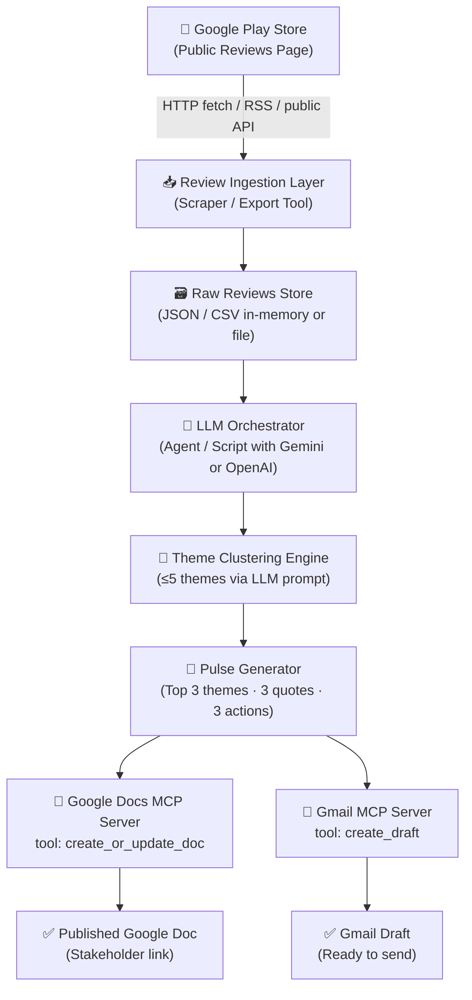
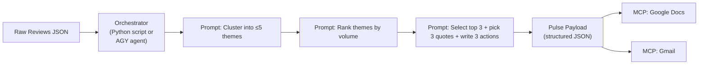
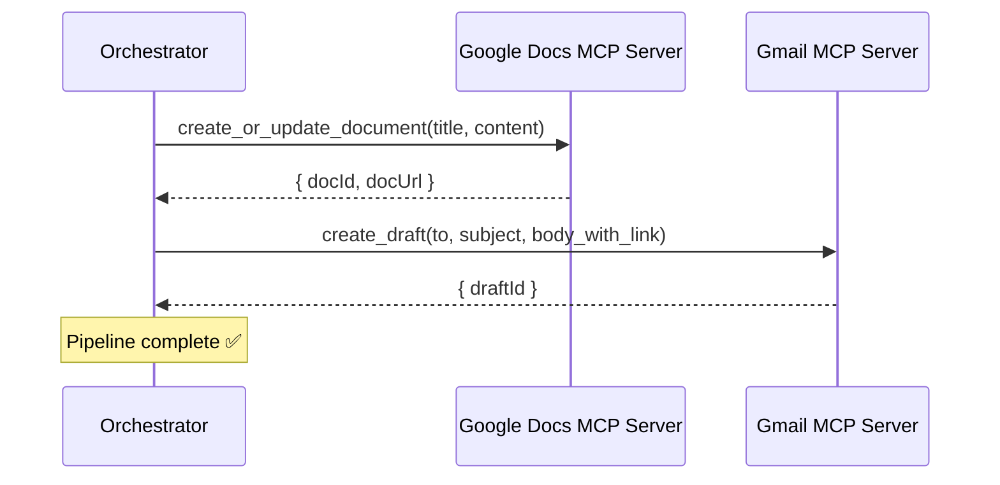
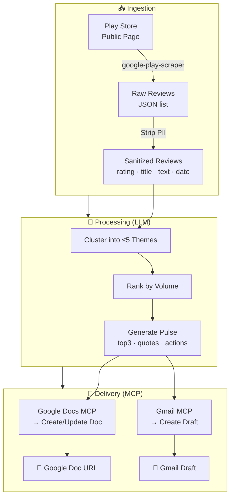
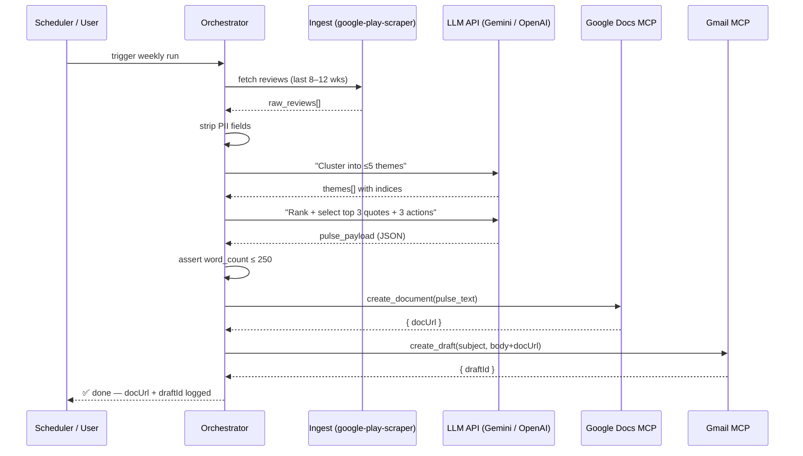

# 🏗️ Groww Reviews MCP — Architecture

> **Project:** Groww Weekly Review Pulse Pipeline
> **Pattern:** MCP-first agent pipeline (no bespoke OAuth / REST wiring)
> **Cadence:** Weekly (repeatable / schedulable)

---

## 1. High-Level Architecture



---

## 2. Layer-by-Layer Breakdown

### 2.1 — Review Ingestion Layer

| Property | Detail |
|---|---|
| **Source** | Google Play Store public reviews for `com.nextbillion.groww` |
| **Method** | Public scraping library (e.g., `google-play-scraper` for Python/Node) — no login, no ToS violation |
| **Window** | Last 8–12 weeks |
| **Fields captured** | `rating` (1–5), `title`, `text`, `date` |
| **Output** | List of review objects (JSON) |
| **PII stripping** | Strip `userName`, `reviewId`, `deviceInfo` before downstream use |

> [!CAUTION]
> Never scrape behind a store login. Use only public, unauthenticated endpoints or official export mechanisms. Reviewer usernames must be dropped immediately at ingestion.

---

### 2.2 — Raw Reviews Store

A lightweight in-memory or flat-file store that holds the sanitized reviews for the current pipeline run.

```
reviews_YYYY-MM-DD.json
└── [ { rating, title, text, date }, ... ]   ← no PII fields
```

- No database required for MVP; a JSON file per weekly run is sufficient.
- If persistence is needed across runs, append to a rolling JSONL log.

---

### 2.3 — LLM Orchestrator

The central agent / script that coordinates all pipeline steps.



**Responsibilities:**
1. Load sanitized reviews from the store.
2. Invoke LLM to cluster reviews into ≤ 5 themes.
3. Invoke LLM to rank clusters by review volume.
4. Invoke LLM to produce the final pulse (top 3 themes, 3 quotes, 3 actions, ≤ 250 words).
5. Call MCP tools to publish to Google Docs and Gmail.

**Implementation options:**
- Python script using `google-generativeai` / `openai` SDK + MCP client
- Antigravity (AGY) agent with MCP tool access
- LangChain / LangGraph agent pipeline

---

### 2.4 — Theme Clustering Engine

Runs as a sequence of LLM prompts inside the Orchestrator.

```
Step 1 — Cluster
  Input : All review texts (sanitized)
  Prompt: "Group these reviews into at most 5 themes. For each theme provide:
           name, short description, list of matching review indices."
  Output: themes[]  → { name, description, reviewIndices[] }

Step 2 — Rank
  Input : themes[] with counts (len(reviewIndices))
  Output: themes sorted by count descending → top3[]

Step 3 — Quote Selection
  Input : top3[] review index lists
  Output: 1 representative verbatim quote per top theme (3 total)
          (anonymised — no username prefix)

Step 4 — Action Ideas
  Input : top3[] theme descriptions + quotes
  Output: 3 concrete, actionable next steps
```

> [!NOTE]
> Candidate themes for Groww: **Onboarding / KYC**, **Payments & Withdrawals**, **Portfolio & Statements**, **App Performance / Crashes**, **Customer Support**. Let the LLM discover natural clusters; use these as fallback labels.

---

### 2.5 — Pulse Generator

Assembles the final structured payload that feeds both MCP integrations.

**Pulse Schema (internal JSON):**
```json
{
  "week_ending": "YYYY-MM-DD",
  "review_count": 0,
  "top_themes": [
    {
      "rank": 1,
      "name": "Theme Name",
      "description": "One-sentence summary",
      "review_count": 0,
      "quote": "Verbatim user text (no username)"
    }
  ],
  "action_ideas": [
    "Action 1 grounded in theme 1",
    "Action 2 grounded in theme 2",
    "Action 3 grounded in theme 3"
  ],
  "word_count": 0
}
```

**Pulse Document (prose, ≤ 250 words):**
```
Groww App — Weekly Review Pulse  [week ending YYYY-MM-DD]
Reviews analysed: N  |  Period: last 8–12 weeks

TOP THEMES
1. <Theme Name> — <Short description>
   Quote: "<verbatim user text>"

2. <Theme Name> — <Short description>
   Quote: "<verbatim user text>"

3. <Theme Name> — <Short description>
   Quote: "<verbatim user text>"

ACTION IDEAS
1. <Concrete next step>
2. <Concrete next step>
3. <Concrete next step>
```

---

### 2.6 — MCP Integrations

Both integrations are called **after** the pulse payload is ready.



#### Google Docs MCP

| Property | Detail |
|---|---|
| **MCP Server** | `@google-workspace/mcp` or equivalent Google Docs MCP server |
| **Tool used** | `create_document` / `update_document` |
| **Doc title** | `Groww Weekly Pulse — YYYY-MM-DD` |
| **Content** | Prose pulse (≤ 250 words) formatted with headings |
| **Sharing** | Doc created in caller's Drive; share link sent in email |

#### Gmail MCP

| Property | Detail |
|---|---|
| **MCP Server** | `@google-workspace/mcp` or equivalent Gmail MCP server |
| **Tool used** | `create_draft` |
| **To** | Self / team alias |
| **Subject** | `[Groww Pulse] Weekly Review Summary — YYYY-MM-DD` |
| **Body** | Short intro + link to Google Doc (or inline pulse if preferred) |
| **State** | Draft only — human sends when ready |

> [!IMPORTANT]
> MCP servers handle all OAuth credential management internally. The Orchestrator only calls named MCP tools — it never touches access tokens, refresh tokens, or HTTP headers directly.

---

## 3. Data Flow Diagram



---

## 4. Component Responsibilities

| Component | Language / Tool | Responsibility |
|---|---|---|
| `ingest.py` | Python | Fetch public Play Store reviews, strip PII, save to JSON |
| `cluster.py` | Python + LLM SDK | Send reviews to LLM, receive ≤5 theme clusters |
| `pulse.py` | Python | Rank themes, select quotes, generate action ideas, format prose |
| `mcp_docs.py` | Python + MCP client | Call Google Docs MCP tool to create/update pulse document |
| `mcp_gmail.py` | Python + MCP client | Call Gmail MCP tool to create draft email |
| `orchestrate.py` | Python | Entry-point — wires all steps in sequence; runnable as cron |
| `config.yaml` | YAML | Week window, theme cap, word limit, target email, MCP server URLs |

---

## 5. Sequence Diagram — Full Pipeline Run



---

## 6. Key Constraints — Architecture Implications

| Constraint | Architectural Decision |
|---|---|
| **Public reviews only** | Scraper uses unauthenticated public endpoints; no cookie/session injection |
| **≤ 5 themes** | Hard cap enforced in cluster prompt; LLM instructed to merge if over limit |
| **≤ 250 words** | Pulse generator checks `word_count`; LLM re-prompted to condense if exceeded |
| **No PII** | Reviewer `userName`, `reviewId`, `deviceInfo` fields dropped at ingestion; quotes checked for email-pattern / phone-number patterns before inclusion |
| **MCP-first** | No raw `requests` calls to Google APIs; all Docs/Gmail actions via MCP tool calls |
| **Weekly cadence** | `orchestrate.py` accepts a `--date` flag; can be scheduled via cron / Task Scheduler / AGY `/schedule` |

---

## 7. Project File Structure (Target)

```
c:\Projects\Grow reviwes_MCP\
├── docs\
│   ├── problemstatement.txt      ← original brief
│   ├── problemstatement.md       ← structured context
│   └── architecture.md           ← this file
│
├── src\
│   ├── ingest.py                 ← Play Store review fetcher + PII stripper
│   ├── cluster.py                ← LLM theme clustering
│   ├── pulse.py                  ← pulse formatter (prose + JSON payload)
│   ├── mcp_docs.py               ← Google Docs MCP tool caller
│   ├── mcp_gmail.py              ← Gmail MCP tool caller
│   └── orchestrate.py            ← main entry point (wires all steps)
│
├── config\
│   └── config.yaml               ← week_window, theme_cap, word_limit, email
│
├── data\
│   └── reviews_YYYY-MM-DD.json   ← sanitized weekly review snapshots
│
├── tests\
│   ├── test_ingest.py
│   ├── test_cluster.py
│   └── test_pulse.py
│
├── requirements.txt              ← Python dependencies
└── README.md                     ← setup & run instructions
```

---

## 8. Technology Stack

| Layer | Choice | Reason |
|---|---|---|
| **Language** | Python 3.11+ | Mature LLM SDKs, scraper libraries, MCP clients |
| **Review Fetcher** | `google-play-scraper` (Python) | Public, unauthenticated, no ToS violation |
| **LLM** | Google Gemini (`google-generativeai`) or OpenAI | Clustering + summarisation prompts |
| **MCP Client** | `mcp` Python SDK or AGY built-in MCP tools | MCP-first requirement |
| **Google Docs MCP** | `@google-workspace/mcp` (or AGY plugin) | Creates/updates pulse document |
| **Gmail MCP** | `@google-workspace/mcp` (or AGY plugin) | Creates draft email |
| **Scheduler** | OS cron / Windows Task Scheduler / AGY `/schedule` | Weekly trigger |
| **Config** | `config.yaml` | Externalise tunable parameters |

---

## 9. Open Questions / Decisions

| # | Question | Options |
|---|---|---|
| 1 | Which LLM provider? | Gemini (native to AGY) vs. OpenAI GPT-4o |
| 2 | Which MCP server for Google Workspace? | AGY built-in plugin vs. standalone `@google-workspace/mcp` |
| 3 | Review fetch library? | `google-play-scraper` (Python) vs. `google-play-scraper` (Node) vs. RSS feed |
| 4 | Pulse stored as new Doc each week or appended to one running Doc? | New doc per week (clean history) vs. append (single source of truth) |
| 5 | Email body: inline pulse or just a Doc link? | Inline (self-contained) vs. link-only (shorter email) |
| 6 | Scheduling mechanism? | AGY `/schedule`, Windows Task Scheduler, or manual trigger |

