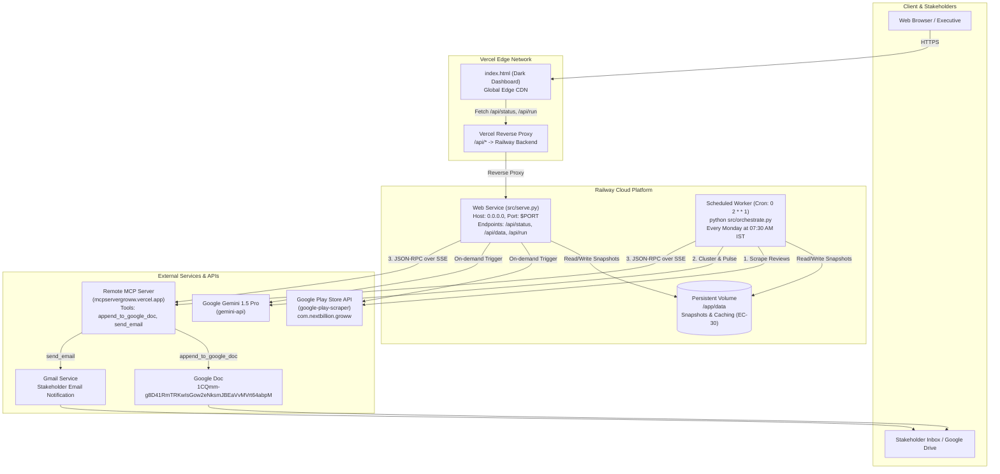
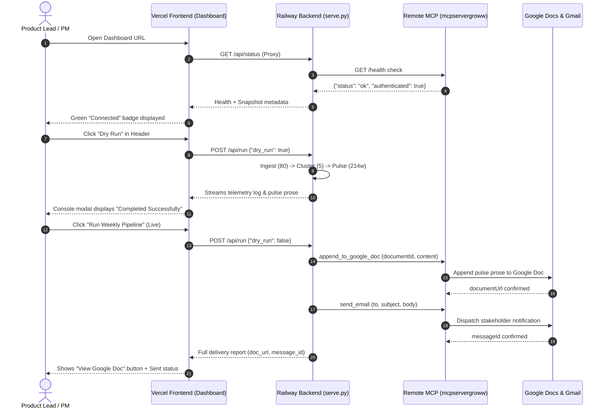

# 🚀 Groww Reviews MCP — Cloud Deployment Plan

> **Target Architecture:**  
> • **Backend API & Weekly Orchestrator:** Deployed on **Railway** (Python 3.11 Runtime, Persistent Volume, Web Service + Scheduled Worker)  
> • **Frontend Dashboard:** Deployed on **Vercel** (Global Edge CDN, Dark Theme Telemetry UI, Reverse-Proxy Rewrites)  
> • **Remote MCP Server:** Already live on **Vercel Serverless** ([`mcpservergroww.vercel.app`](https://mcpservergroww.vercel.app))  
> • **Google Workspace Delivery:** Appends to Google Doc (`1BxiMVs...`) and dispatches Gmail notifications via MCP  

---

## 1. System Topology & Data Flow



---

## 2. Platform & Service Matrix

| Component | Platform | Deployment Type | Entry Point | Public URL / Port |
|---|---|---|---|---|
| **Backend API** | **Railway** | Nixpacks Python 3.11 Web Service | `python src/serve.py` | `https://growwreviewsmcpserver-production.up.railway.app` |
| **Scheduled Pipeline** | **Railway** | Cron Worker (Every Mon 07:30 IST) | `python src/orchestrate.py` | Internal (Background Worker) |
| **Frontend UI** | **Vercel** | Static Site + API Rewrites | `index.html` + `vercel.json` | `https://groww-reviews-pulse.vercel.app` |
| **Remote MCP Server** | **Vercel** | Serverless Streamable HTTP | Python/TypeScript MCP | `https://mcpservergroww.vercel.app/mcp` |
| **Target Document** | **Google Docs**| Cloud Document | MCP Append Tool | ID: `1CQmm-g8D41RmTRKwIsGow2eNksmJBEaVvMVrt64abpM` |

---

## 3. Pre-Flight Checklist & Prerequisites

- [ ] **GitHub Repository:** Code pushed to GitHub (`main` branch).
- [ ] **Railway Account:** [railway.com](https://railway.com) (free or team plan).
- [ ] **Vercel Account:** [vercel.com](https://vercel.com) (Hobby or Pro).
- [ ] **Google Gemini API Key:** Active key from [Google AI Studio](https://aistudio.google.com/app/apikey).
- [ ] **Verified Remote MCP Health:** `https://mcpservergroww.vercel.app/health` returns HTTP 200 `{"status": "ok", "authenticated": true}`.

---

## 4. Phase 1 — Deploy Backend on Railway

Railway will host both the real-time API server ([`src/serve.py`](file:///c:/Projects/Grow%20reviwes_MCP/src/serve.py)) and the automated weekly cron worker ([`src/orchestrate.py`](file:///c:/Projects/Grow%20reviwes_MCP/src/orchestrate.py)).

### 4.1 — Deployment Configuration Files
The repository includes all necessary Railway descriptors:
* **[`railway.json`](file:///c:/Projects/Grow%20reviwes_MCP/railway.json):**
  ```json
  {
    "$schema": "https://railway.app/railway.schema.json",
    "build": {
      "builder": "NIXPACKS"
    },
    "deploy": {
      "startCommand": "python src/serve.py",
      "healthcheckPath": "/api/status",
      "healthcheckTimeout": 120,
      "restartPolicyType": "ON_FAILURE",
      "restartPolicyMaxRetries": 3
    }
  }
  ```
* **[`Procfile`](file:///c:/Projects/Grow%20reviwes_MCP/Procfile):**
  ```text
  web: python src/serve.py
  ```
* **[`runtime.txt`](file:///c:/Projects/Grow%20reviwes_MCP/runtime.txt):**
  ```text
  python-3.11.9
  ```

### 4.2 — Railway Environment Variables Configuration
Configure the following environment variables in the Railway Web Console under **Service Settings → Variables**:

| Variable Name | Required | Recommended Production Value | Description |
|---|:---:|---|---|
| `PORT` | Auto | *Set by Railway (e.g. 8080)* | Port that `src/serve.py` binds to |
| `HOST` | Yes | `0.0.0.0` | Bind address for container networking |
| `GROQ_API_KEY` | Yes (if Groq) | `gsk_...` (Secret) | Groq API key (active default in config.yaml) |
| `GEMINI_API_KEY` | Yes (if Gemini) | `AIzaSy...` (Secret) | Google Gemini API key |
| `PYTHONUNBUFFERED` | Yes | `1` | Ensures real-time console log streaming |
| `MCP_SERVER_URL` | Optional | `https://mcpservergroww.vercel.app/mcp` | Remote MCP SSE endpoint |
| `MCP_HEALTH_URL` | Optional | `https://mcpservergroww.vercel.app/health` | Pre-flight health endpoint |
| `GOOGLE_DOC_ID` | Optional | `1CQmm-g8D41RmTRKwIsGow2eNksmJBEaVvMVrt64abpM` | Stakeholder Google Doc ID |
| `EMAIL_TO` | Optional | `stakeholders@groww.in` | Target stakeholder email address |

### 4.3 — Persistent Volume (Optional but Recommended)
To preserve weekly JSON review and pulse snapshots across deployments and leverage snapshot caching (`EC-30`):
1. In Railway project canvas, click **+ New → Volume**.
2. Mount the volume to the Web Service at path:
   ```text
   /app/data
   ```
3. Set volume size: `1 GB` (sufficient for years of 12-week snapshots).

### 4.4 — Step-by-Step Railway Deployment

#### Method A: Deploy via GitHub Integration (Recommended)
1. Go to [railway.com/new](https://railway.com/new) and select **Deploy from GitHub repo**.
2. Select repository: `snigdhapanda1410/Grow-reviwes_MCP` (or your repo name).
3. Railway automatically detects `railway.json` and Nixpacks Python builder.
4. Go to **Variables** tab and add `GEMINI_API_KEY` and `HOST=0.0.0.0`.
5. Go to **Settings → Networking** and click **Generate Domain**.
   * Live backend URL: `https://growwreviewsmcpserver-production.up.railway.app`
6. Wait for build to complete. The health check (`/api/status`) will verify the service.

#### Method B: Deploy via Railway CLI
```powershell
# Install Railway CLI
npm install -g @railway/cli

# Authenticate
railway login

# Link or initialize project
railway init
# (Choose: "Empty Project" or link to existing)

# Link service
railway link

# Set production environment variables
railway variables --set GEMINI_API_KEY="your-api-key"
railway variables --set HOST="0.0.0.0"

# Deploy local files to Railway
railway up
```

### 4.5 — Verify Backend Deployment
Test the live Railway endpoint using PowerShell:
```powershell
# 1. Healthcheck and status endpoint
Invoke-RestMethod -Uri "https://YOUR_RAILWAY_APP.up.railway.app/api/status"

# Expected JSON response:
# {
#   "status": "ok",
#   "mcp": { "status": "ok", "authenticated": true, "tools": ["send_email", "append_to_google_doc"] },
#   "snapshots": ["2026-11-10", "2026-11-01"]
# }

# 2. Trigger dry-run pipeline test over API
Invoke-RestMethod -Uri "https://YOUR_RAILWAY_APP.up.railway.app/api/run" -Method POST -Body '{"dry_run": true, "date": "2026-11-01"}' -ContentType "application/json"
```

---

## 5. Phase 2 — Schedule Weekly Automation on Railway

To execute the review pulse pipeline autonomously every week without manual intervention:

### Option A: Railway Cron Service (Native)
1. In the same Railway Project canvas, click **+ New → Service → Empty Service**.
2. Name the service: `pulse-weekly-scheduler`.
3. In **Settings → Source Repo**, connect your GitHub repository.
4. In **Settings → Cron Schedule**, enter:
   ```text
   0 2 * * 1
   ```
   *(Runs every Monday at 02:00 AM UTC, which equals 07:30 AM IST).*
5. In **Settings → Deploy → Custom Command**, set:
   ```bash
   python src/orchestrate.py
   ```
6. Link shared environment variables (`GEMINI_API_KEY`, etc.) and the `/app/data` volume.

### Option B: GitHub Actions Scheduled Workflow (Alternative)
Create `.github/workflows/weekly-pulse.yml` in the repository:
```yaml
name: Groww Weekly Pulse Cron

on:
  schedule:
    # Every Monday at 02:00 UTC (07:30 AM IST)
    - cron: '0 2 * * 1'
  workflow_dispatch: # Allows manual trigger from GitHub UI

jobs:
  run-pulse:
    runs-on: ubuntu-latest
    steps:
      - name: Trigger Pipeline on Railway Backend
        run: |
          curl -X POST https://${{ secrets.RAILWAY_BACKEND_URL }}/api/run \
            -H "Content-Type: application/json" \
            -d '{"dry_run": false}'
```

---

## 6. Phase 3 — Deploy Frontend on Vercel

Vercel will serve the dark telemetry dashboard ([`index.html`](file:///c:/Projects/Grow%20reviwes_MCP/index.html)) over global edge CDN and automatically proxy `/api/*` calls to the Railway backend, completely eliminating CORS friction.

### 6.1 — Vercel Configuration ([`vercel.json`](file:///c:/Projects/Grow%20reviwes_MCP/vercel.json))
Update `vercel.json` with your actual Railway backend domain:

```json
{
  "version": 2,
  "cleanUrls": true,
  "framework": null,
  "rewrites": [
    {
      "source": "/api/(.*)",
      "destination": "https://YOUR_RAILWAY_APP.up.railway.app/api/$1"
    }
  ],
  "headers": [
    {
      "source": "/(.*)",
      "headers": [
        { "key": "X-Content-Type-Options", "value": "nosniff" },
        { "key": "X-Frame-Options", "value": "DENY" },
        { "key": "X-XSS-Protection", "value": "1; mode=block" }
      ]
    }
  ]
}
```

### 6.2 — Step-by-Step Vercel Deployment

#### Method A: Deploy via Vercel Web Dashboard (Recommended)
1. Go to [vercel.com/new](https://vercel.com/new).
2. Import repository: `snigdhapanda1410/Grow-reviwes_MCP`.
3. In **Project Settings**:
   * **Framework Preset:** `Other`
   * **Root Directory:** `./`
   * **Build Command:** *(leave empty)*
   * **Output Directory:** `./`
4. Click **Deploy**.
5. Once deployed, Vercel assigns a live production URL:
   * Example: `https://groww-reviews-pulse.vercel.app`

#### Method B: Deploy via Vercel CLI
```powershell
# Install Vercel CLI
npm install -g vercel

# Login
vercel login

# Deploy preview
vercel

# Deploy to production
vercel --prod
```

### 6.3 — Verify Frontend Deployment
1. Navigate to `https://groww-reviews-pulse.vercel.app`.
2. Verify all dashboard elements render:
   - Groww live pulse beacon (`Live Pipeline • Week ending Nov 01, 2026`).
   - MCP Server status badge (`mcpservergroww.vercel.app (Connected)`).
   - 4 Hero KPI Cards with metrics and progress bar.
   - Top 3 Voice of Customer Themes with volume/severity toggles.
   - Ingestion Stream table rendering all 80 cleaned reviews.
3. Open Developer Tools (`F12` → Network tab):
   - Notice `/api/status` calls succeed seamlessly via Vercel edge reverse-proxy.

---

## 7. Phase 4 — End-to-End Validation Runbook

Run this verification workflow once both services are deployed:



### Validation Steps:
1. **Header Action Check:** Click **"Open Google Doc"** in the top navigation bar. Verify it navigates to document [`1CQmm-g8D41RmTRKwIsGow2eNksmJBEaVvMVrt64abpM`](https://docs.google.com/document/d/1CQmm-g8D41RmTRKwIsGow2eNksmJBEaVvMVrt64abpM/edit).
2. **Prose Copy Check:** Click **"Copy Pulse Prose"** in the MCP Delivery Hub card. Confirm clipboard contains the formatted 214-word note and animated toast confirms.
3. **Table Filter Check:** Click `1-Star (37)`, `2-Star (2)`, `3-Star (9)`, `4-5 Star (32)` pills and test keyword search (e.g. `adapter`, `font`). Confirm counts and filtered rows update instantly.
4. **Execution Telemetry Check:** Click **"Run Weekly Pipeline"**. Confirm modal shows 5 green steps and provides direct link to updated Google Doc.

---

## 8. Operational Hardening & Disaster Recovery

### 8.1 — Log Monitoring
- **Railway Logs:**
  ```powershell
  # Stream live production backend logs
  railway logs --service web
  ```
- **Vercel Edge Logs:** Accessible in Vercel Dashboard → **Logs & Monitoring**.

### 8.2 — Failure Modes & Mitigations

| Failure Scenario | Automatic Defensive Behavior | Operator Action |
|---|---|---|
| **Google Play Store rate limit / block** | Scraper retries 3× with exponential backoff (2s, 4s, 8s). | Pipeline automatically uses cached snapshot from `data/reviews_YYYY-MM-DD.json` (`EC-30`). |
| **Gemini API quota exhausted** | Code catches LLM error and engages `_heuristic_clusters()` fallback. | Pipeline completes with rule-based clusters; rotate `GEMINI_API_KEY` in Railway variables. |
| **Remote MCP server 504 / timeout** | Pre-flight check fails fast (`check_mcp_health`) before mutation attempt. | Check Vercel MCP health at `https://mcpservergroww.vercel.app/health`. |
| **Docs append succeeds, Gmail fails (`EC-35`)** | Document URL logged prominently before raising error; status code preserved. | Stakeholders can still access the living Google Doc directly via link. |
| **Snapshot disk space overflow** | `cleanup_old_snapshots()` automatically prunes files older than 12 weeks. | Storage footprint remains strictly bounded under 25 MB. |

### 8.3 — Rollback Procedure
- **Frontend Rollback:** In Vercel Dashboard → **Deployments**, click the previous successful deployment and select **Instant Rollback**.
- **Backend Rollback:** In Railway Console → **Deployments**, select previous healthy commit and click **Redeploy**.

