# ⚠️ Groww Reviews MCP — Edge Cases & Corner Scenarios

> **Scope:** Covers all 5 pipeline layers — Ingestion · Clustering · Pulse Generation · MCP Delivery · Orchestration
> **Purpose:** Reference this document during implementation (Phase 3–6) and whenever adding defensive code or tests.

---

## Index

| # | Layer | Category | Severity |
|---|---|---|---|
| [EC-01](#ec-01) | Ingestion | Zero reviews returned | 🔴 Critical |
| [EC-02](#ec-02) | Ingestion | Fewer than 3 reviews returned | 🟠 High |
| [EC-03](#ec-03) | Ingestion | Play Store rate-limited / blocked | 🟠 High |
| [EC-04](#ec-04) | Ingestion | All reviews in non-English language | 🟡 Medium |
| [EC-05](#ec-05) | Ingestion | Review text is empty / whitespace only | 🟡 Medium |
| [EC-06](#ec-06) | Ingestion | Duplicate reviews in fetched batch | 🟡 Medium |
| [EC-07](#ec-07) | Ingestion | PII embedded inside review text | 🔴 Critical |
| [EC-08](#ec-08) | Ingestion | Review date missing or malformed | 🟡 Medium |
| [EC-09](#ec-09) | Ingestion | Extremely long review text (>2000 chars) | 🟡 Medium |
| [EC-10](#ec-10) | Ingestion | All reviews are 5-star (positive only) | 🟢 Low |
| [EC-11](#ec-11) | Clustering | LLM returns > 5 themes | 🟠 High |
| [EC-12](#ec-12) | Clustering | LLM returns < 3 themes | 🟠 High |
| [EC-13](#ec-13) | Clustering | LLM returns malformed / non-JSON response | 🔴 Critical |
| [EC-14](#ec-14) | Clustering | Review indices out of bounds in LLM response | 🟠 High |
| [EC-15](#ec-15) | Clustering | Duplicate review indices across themes | 🟡 Medium |
| [EC-16](#ec-16) | Clustering | One theme dominates (>90% of reviews) | 🟡 Medium |
| [EC-17](#ec-17) | Clustering | LLM invents themes not grounded in reviews | 🟡 Medium |
| [EC-18](#ec-18) | Pulse | Generated prose exceeds 250 words | 🟠 High |
| [EC-19](#ec-19) | Pulse | LLM paraphrases instead of quoting verbatim | 🔴 Critical |
| [EC-20](#ec-20) | Pulse | Quote contains PII despite ingestion stripping | 🔴 Critical |
| [EC-21](#ec-21) | Pulse | Action ideas are generic / not grounded | 🟡 Medium |
| [EC-22](#ec-22) | Pulse | Fewer than 3 unique quotes available | 🟡 Medium |
| [EC-23](#ec-23) | Pulse | Action ideas duplicate each other | 🟢 Low |
| [EC-24](#ec-24) | MCP — Docs | MCP server unreachable at runtime | 🔴 Critical |
| [EC-25](#ec-25) | MCP — Docs | Google Doc creation returns no URL | 🟠 High |
| [EC-26](#ec-26) | MCP — Docs | Doc title collision (same-week re-run) | 🟡 Medium |
| [EC-27](#ec-27) | MCP — Gmail | Gmail draft creation silently fails | 🟠 High |
| [EC-28](#ec-28) | MCP — Gmail | Email recipient address is invalid | 🟡 Medium |
| [EC-29](#ec-29) | MCP — Gmail | Draft body exceeds provider size limit | 🟢 Low |
| [EC-30](#ec-30) | Orchestration | Pipeline re-run on same date (idempotency) | 🟠 High |
| [EC-31](#ec-31) | Orchestration | LLM API key expired / quota exceeded | 🔴 Critical |
| [EC-32](#ec-32) | Orchestration | `config.yaml` is missing or malformed | 🟠 High |
| [EC-33](#ec-33) | Orchestration | `data/` directory does not exist | 🟡 Medium |
| [EC-34](#ec-34) | Orchestration | Scheduled run fires during Play Store downtime | 🟡 Medium |
| [EC-35](#ec-35) | Orchestration | Partial run failure (Docs succeeds, Gmail fails) | 🟠 High |

---

## 🔴 Critical

---

### EC-01
**Layer:** Ingestion
**Scenario:** Zero reviews returned from Play Store for the configured date window.

| Field | Detail |
|---|---|
| **Trigger** | App ID wrong; Play Store API returns empty; date window too narrow |
| **Impact** | All downstream steps (cluster, pulse, delivery) would produce garbage or crash |
| **Detection** | `len(reviews) == 0` after fetch |
| **Handling** | Raise `IngestError("No reviews fetched for window")`. Log the app ID, date range, and country used. Abort pipeline. Do NOT create an empty Google Doc. |
| **Test** | Mock scraper returning `[]`; assert `IngestError` raised before LLM is called |

---

### EC-07
**Layer:** Ingestion
**Scenario:** A reviewer includes personal information inside the review body text (e.g., *"my email is user@gmail.com, please help"* or *"call me on 9876543210"*).

| Field | Detail |
|---|---|
| **Trigger** | Users sometimes post contact info hoping for support resolution |
| **Impact** | PII leaks into quotes, Google Doc, Gmail draft — compliance violation |
| **Detection** | Regex scan on `content` field: email pattern, Indian mobile number pattern, Aadhaar-like 12-digit sequence |
| **Handling** | Replace matched spans with `[REDACTED]` before storing. Apply again to final selected quotes before inserting into pulse. Log redaction count per run. |
| **Regex patterns** | `[a-zA-Z0-9_.+-]+@[a-zA-Z0-9-]+\.[a-zA-Z0-9-.]+` · `(\+91[\-\s]?)?[6-9]\d{9}` · `\b\d{4}\s\d{4}\s\d{4}\b` |
| **Test** | Feed synthetic review with email + phone; assert both replaced with `[REDACTED]` in output |

> [!CAUTION]
> PII redaction must happen at **two points**: (1) immediately after fetch in `ingest.py`, and (2) again on the selected quote strings in `pulse.py` — because the LLM may reconstruct partial patterns.

---

### EC-13
**Layer:** Clustering
**Scenario:** LLM returns a response that is not valid JSON (e.g., preamble text, truncated JSON, markdown code fences around JSON that were not stripped).

| Field | Detail |
|---|---|
| **Trigger** | Model adds explanation text before/after JSON; token limit truncates the array; model returns prose instead of structured output |
| **Detection** | `json.loads()` raises `JSONDecodeError` |
| **Handling** | (1) Strip markdown fences (` ```json ... ``` `) before parsing. (2) If still invalid, re-prompt once with stricter instruction: *"Return ONLY valid JSON. No markdown, no explanation."* (3) If second attempt also fails, raise `ClusterError` and abort. |
| **Test** | Mock LLM returning `"Here are the themes: [...]"` — assert strip + parse succeeds; mock returning pure prose — assert `ClusterError` raised after 2 attempts |

---

### EC-19
**Layer:** Pulse Generation
**Scenario:** LLM paraphrases or rewrites the user's review text instead of copying it verbatim as a quote.

| Field | Detail |
|---|---|
| **Trigger** | LLM instructed to "select a quote" but instead summarises |
| **Impact** | Violates the hard requirement: *"no invented wording"*; misleads stakeholders |
| **Detection** | Heuristic: check if the quote text appears as a substring of any review in the theme's review list (case-insensitive, after punctuation normalisation) |
| **Handling** | If quote is not found verbatim in source reviews, re-prompt: *"Copy the exact text from the review. Do not paraphrase."* If second attempt fails, fall back to selecting the highest-rated review's `content[:200]` directly in code (no LLM). |
| **Test** | Provide known review texts; assert selected quote is a substring of one of them |

---

### EC-20
**Layer:** Pulse Generation
**Scenario:** A selected quote passes ingestion PII stripping but still contains PII after LLM reconstruction or context stitching.

| Field | Detail |
|---|---|
| **Trigger** | LLM may combine fragments from multiple reviews; partial phone numbers re-assembled; model adds context like *"user John says..."* |
| **Impact** | PII in final Google Doc and Gmail draft |
| **Handling** | Run the same PII regex scan on every selected quote string in `pulse.py` **before** assembling the prose document. Redact or drop the quote if a match is found; pick the next candidate from the theme. |
| **Test** | Inject a mock quote containing a phone number; assert it is redacted before pulse assembly |

---

### EC-24
**Layer:** MCP — Docs
**Scenario:** The Google Docs MCP server is unreachable when `mcp_docs.py` tries to connect.

| Field | Detail |
|---|---|
| **Trigger** | MCP server not running; network outage; auth token expired; wrong server name in `config.yaml` |
| **Impact** | Pulse generated but never delivered; silent failure if not caught |
| **Detection** | Connection timeout / `MCPConnectionError` from MCP SDK |
| **Handling** | Raise immediately with a human-readable message: *"Google Docs MCP server '{server_name}' unreachable. Check MCP server is running and authenticated."* Do NOT proceed to Gmail step — fail fast. Log the full error. |
| **Test** | Mock MCP connection to raise `ConnectionError`; assert pipeline aborts with clear log message |

---

### EC-31
**Layer:** Orchestration
**Scenario:** The LLM API key is expired, revoked, or the daily/minute quota is exceeded mid-run.

| Field | Detail |
|---|---|
| **Trigger** | Key rotated; free-tier quota hit; billing issue |
| **Impact** | Clustering or pulse generation step crashes; partial run with no output |
| **Detection** | `google.api_core.exceptions.ResourceExhausted` / `openai.RateLimitError` / HTTP 429 |
| **Handling** | Catch at the LLM call wrapper level. For quota errors: wait 60s and retry once. For auth errors: raise `ConfigError("LLM API key invalid or expired")` and abort immediately. Log which step failed. |
| **Test** | Mock API returning 429; assert single retry with delay; mock returning 401; assert immediate abort |

---

## 🟠 High

---

### EC-02
**Layer:** Ingestion
**Scenario:** Fewer than 3 reviews returned (e.g., 1 or 2).

| Field | Detail |
|---|---|
| **Trigger** | Very new app version; narrow date window; Play Store paginates and only first page is fetched |
| **Impact** | Can't produce 3 distinct quotes; clustering is meaningless on 1–2 items |
| **Handling** | If `len(reviews) < 3`, warn and attempt to widen the date window by +2 weeks (up to a max of 16 weeks). If still < 3, raise `IngestError("Insufficient reviews: {N} found, minimum 3 required")`. |
| **Test** | Mock returning 2 reviews; assert window expansion attempted; mock expansion also returning 2; assert error raised |

---

### EC-03
**Layer:** Ingestion
**Scenario:** Play Store returns a rate-limit error (HTTP 429) or connection timeout.

| Field | Detail |
|---|---|
| **Trigger** | Too many requests in short period; scheduled run fires alongside another process |
| **Handling** | Exponential backoff: wait 5s → 15s → 45s across 3 attempts. If all 3 fail, raise `IngestError("Play Store fetch failed after 3 retries")`. |
| **Test** | Mock first 2 calls raising `ConnectionError`, third succeeding; assert correct retry count |

---

### EC-11
**Layer:** Clustering
**Scenario:** LLM returns more than 5 themes despite the prompt constraint.

| Field | Detail |
|---|---|
| **Trigger** | Large review set with many distinct topics; model ignores `AT MOST 5` instruction |
| **Handling** | (1) Detect: `len(themes) > config.pulse.max_themes`. (2) Auto-merge: combine the two smallest themes (by `len(review_indices)`) into one, labelled *"Other / Miscellaneous"*. Repeat until count ≤ 5. Log merges performed. (3) If merging results in a theme with a vacuous name, re-prompt with explicit count: *"You returned {N} themes. Merge them down to exactly 5."* |
| **Test** | Mock LLM returning 7 themes; assert output contains ≤ 5 themes after merging |

---

### EC-12
**Layer:** Clustering
**Scenario:** LLM returns fewer than 3 themes (can't populate 3 required top themes).

| Field | Detail |
|---|---|
| **Trigger** | Very homogeneous review set (e.g., everyone only talks about KYC); small review batch |
| **Handling** | Use however many themes exist (e.g., 2). Pulse is still valid — label missing slots as *"Insufficient data for theme {N}"* and skip that quote/action. Log warning: *"Only {N} themes found; pulse will have {N} entries instead of 3."* Do NOT pad with fabricated themes. |
| **Test** | Mock 2-theme LLM response; assert pulse contains 2 themes + 2 quotes + 2 actions; no crash |

---

### EC-14
**Layer:** Clustering
**Scenario:** LLM's `review_indices` list contains indices that are out of bounds for the actual reviews array.

| Field | Detail |
|---|---|
| **Trigger** | LLM hallucinates indices beyond the actual list length; off-by-one errors |
| **Impact** | `IndexError` at quote selection time |
| **Handling** | After receiving clusters, validate all indices: `assert all(0 <= i < len(reviews) for i in theme.review_indices)`. Remove invalid indices silently and log: *"Removed {N} invalid indices from theme '{name}'"*. If a theme becomes empty after removal, drop it. |
| **Test** | Mock LLM returning indices [0, 999] for a 10-review dataset; assert index 999 is removed; theme retained if others valid |

---

### EC-18
**Layer:** Pulse Generation
**Scenario:** Generated prose exceeds the 250-word limit after the first LLM pass.

| Field | Detail |
|---|---|
| **Trigger** | Themes have long descriptions; action ideas are verbose; LLM ignores word-count instruction |
| **Handling** | Count words after generation: `len(prose.split())`. If > 250, re-prompt: *"The following text is {N} words. Shorten it to under 250 words. Preserve all 3 themes, all 3 quotes (verbatim), and all 3 action ideas."* If still > 250 after second pass, truncate action ideas to 1 sentence each in code. Assert `word_count ≤ 250` before delivery. |
| **Test** | Mock LLM returning 300-word prose; assert re-prompt triggered; mock second return at 240 words; assert passes |

---

### EC-25
**Layer:** MCP — Docs
**Scenario:** MCP `create_document` call succeeds but returns no URL or an empty `docId`.

| Field | Detail |
|---|---|
| **Trigger** | MCP server bug; partial auth; Drive quota exceeded |
| **Handling** | Check `docUrl` is non-empty string after call. If empty, raise `DeliveryError("Google Doc created but no URL returned")`. Log the raw MCP response for debugging. |
| **Test** | Mock MCP returning `{"docId": "", "docUrl": ""}` ; assert `DeliveryError` raised |

---

### EC-27
**Layer:** MCP — Gmail
**Scenario:** Gmail `create_draft` call returns without error but the draft is not visible in Gmail.

| Field | Detail |
|---|---|
| **Trigger** | MCP server swallows errors; draft created in wrong account; spam filter intercepts |
| **Handling** | Validate that `draftId` is a non-empty string in the response. Log the `draftId` prominently so it can be cross-checked in Gmail. Add a note in the log: *"Verify draft ID {draftId} is visible in Gmail Drafts."* |
| **Test** | Mock MCP returning `{"draftId": ""}` ; assert `DeliveryError` raised |

---

### EC-30
**Layer:** Orchestration
**Scenario:** The pipeline is re-run on the same date (e.g., a retry after a failure, or a manual re-run).

| Field | Detail |
|---|---|
| **Trigger** | Partial failure on first run; user manually re-triggers |
| **Impact** | Creates a duplicate Google Doc and Gmail draft; `data/` file overwritten |
| **Handling** | Check if `data/reviews_{date}.json` already exists. If yes, prompt (or auto-proceed in `--force` mode): skip ingestion and reuse cached reviews. For Google Doc, append ` (v2)` to title if a doc with the same title exists (MCP servers typically don't deduplicate). Log: *"Re-run detected for {date}. Using cached reviews."* |
| **Test** | Run twice on same date; assert second run uses cached JSON; assert doc title has ` (v2)` suffix |

---

### EC-35
**Layer:** Orchestration
**Scenario:** Google Docs MCP step succeeds (Doc created, URL returned), but Gmail MCP step fails.

| Field | Detail |
|---|---|
| **Trigger** | Gmail quota exceeded; Gmail MCP auth expired independently of Docs MCP |
| **Impact** | Pulse is published but stakeholder has no email notification |
| **Handling** | Log the `docUrl` prominently **before** attempting Gmail. On Gmail failure, catch error, log it as `ERROR`, and print the `docUrl` to stdout so the user can manually share it. Do NOT roll back the Google Doc. Exit with non-zero code so the scheduler knows the run was incomplete. |
| **Test** | Mock Docs succeeding + Gmail raising error; assert `docUrl` is logged before error; assert non-zero exit |

---

### EC-32
**Layer:** Orchestration
**Scenario:** `config/config.yaml` is missing, empty, or contains malformed YAML.

| Field | Detail |
|---|---|
| **Trigger** | First-time setup incomplete; file accidentally deleted; syntax error introduced |
| **Handling** | Wrap config load in `try/except`. On `FileNotFoundError`: print setup instructions and exit 1. On `yaml.YAMLError`: print the offending line and exit 1. Never proceed with defaults silently — wrong config leads to wrong output. |
| **Test** | Call `load_config("nonexistent.yaml")`; assert `SystemExit(1)` with helpful message |

---

## 🟡 Medium

---

### EC-04
**Layer:** Ingestion
**Scenario:** A large proportion of fetched reviews are in Hindi, Hinglish, or other regional languages.

| Field | Detail |
|---|---|
| **Trigger** | Groww is an Indian app; many users write in Hindi or mixed-script Hinglish |
| **Impact** | LLM clustering may be less accurate; quotes in non-English may confuse English-reading stakeholders |
| **Handling** | Log language distribution in the ingestion report. Pass all reviews to the LLM regardless — modern LLMs handle multilingual input well. If a selected quote is in a non-Latin script, instruct the LLM to also provide an English translation in brackets: `"[Translation: ...]"`. |
| **Test** | Include 5 Hindi-text reviews in fixture; assert pipeline does not crash; assert quote for that theme is present |

---

### EC-05
**Layer:** Ingestion
**Scenario:** A review's `content` field is empty, whitespace-only, or just punctuation (e.g., *"."*, *"!!!!"*).

| Field | Detail |
|---|---|
| **Trigger** | Users submit star ratings without text; scraper returns empty strings |
| **Handling** | Filter out reviews where `content.strip()` has fewer than 10 characters before clustering. Log count: *"Skipped {N} reviews with empty/short content."* |
| **Test** | Include reviews with `""`, `"  "`, `"!!!"`, `"ok"` in fixture; assert all filtered before LLM call |

---

### EC-06
**Layer:** Ingestion
**Scenario:** The same review appears multiple times in the fetched batch.

| Field | Detail |
|---|---|
| **Trigger** | Pagination overlap; scraper called twice; Play Store deduplication not guaranteed |
| **Handling** | Deduplicate on `(content_hash, date)` before saving. Log: *"Removed {N} duplicate reviews."* |
| **Test** | Feed list with 2 identical review objects; assert output contains only 1 |

---

### EC-08
**Layer:** Ingestion
**Scenario:** A review's `at` (date) field is `None`, malformed, or a future date.

| Field | Detail |
|---|---|
| **Trigger** | Scraper API response inconsistency; timezone conversion edge cases |
| **Handling** | If date is `None` or unparseable: assign `date = "unknown"` and include the review (content is still valid). If date is in the future: discard the review and log a warning. |
| **Test** | Feed review with `at=None` and `at="not-a-date"` and `at=future_date`; assert correct handling of each |

---

### EC-09
**Layer:** Ingestion
**Scenario:** A review's `content` is extremely long (>2000 characters) — e.g., a user wrote a paragraph-long complaint.

| Field | Detail |
|---|---|
| **Trigger** | Power users; detailed bug reports |
| **Impact** | Very large prompt token counts when sending all reviews to LLM; risk of exceeding context window |
| **Handling** | Truncate `content` to 500 characters with a trailing `"..."` before passing to LLM. Store the full text in the JSON snapshot. Use truncated version only for clustering/quoting. |
| **Test** | Feed review with 3000-char content; assert LLM receives at most 500 chars for that review |

---

### EC-15
**Layer:** Clustering
**Scenario:** The same review index appears in multiple themes in the LLM's response.

| Field | Detail |
|---|---|
| **Trigger** | LLM ambiguity; a review touches two topics |
| **Handling** | Assign each index to the first theme it appears in (order = LLM's returned order). Remove from all subsequent themes. Log: *"Removed {N} duplicate indices."* |
| **Test** | Mock LLM returning index 3 in both theme A and theme B; assert index 3 in theme A only |

---

### EC-16
**Layer:** Clustering
**Scenario:** One theme captures >90% of reviews (e.g., everyone is complaining about a single outage).

| Field | Detail |
|---|---|
| **Trigger** | Post-incident spike; app crash wave; payment outage |
| **Impact** | Pulse becomes one-dimensional; other themes have < 3 reviews each — quoting is impossible |
| **Handling** | Proceed normally — this is a valid signal. Flag it in the pulse: *"⚠️ Note: Theme '{name}' accounts for {N}% of reviews this week — an unusually concentrated signal."* Add this flag automatically when theme share > 70%. |
| **Test** | Mock 90-review dataset where 85 belong to one theme; assert warning flag in pulse payload |

---

### EC-17
**Layer:** Clustering
**Scenario:** LLM creates themes that are not grounded in the actual review content (hallucinated themes).

| Field | Detail |
|---|---|
| **Trigger** | LLM applies prior knowledge about Groww rather than sticking to the provided text |
| **Detection** | After clustering, verify: for each theme, at least one review in its `review_indices` list contains a keyword from the theme's `description`. Heuristic check — not 100% reliable. |
| **Handling** | If a theme's description has zero keyword overlap with its assigned reviews, log a warning: *"Theme '{name}' may be hallucinated — low keyword overlap with assigned reviews."* Proceed but flag it. |
| **Test** | Mock LLM assigning reviews about "login speed" to a theme named "Tax Filing Feature" — assert overlap warning logged |

---

### EC-21
**Layer:** Pulse Generation
**Scenario:** LLM generates action ideas that are generic and not grounded in the specific themes (e.g., *"Improve user experience"*).

| Field | Detail |
|---|---|
| **Trigger** | Vague theme descriptions; LLM defaulting to safe generic advice |
| **Detection** | Heuristic: check if the action idea contains at least one keyword from the theme name or description |
| **Handling** | If action idea contains none of the theme's keywords, append the theme name explicitly: *"Re: {theme_name} — {generic_action}"*. Also add a note in the log: *"Action idea for theme '{name}' may be generic — review manually."* |
| **Test** | Mock LLM returning "Improve UX" for a "KYC Failures" theme; assert theme name is prepended |

---

### EC-22
**Layer:** Pulse Generation
**Scenario:** A theme has fewer reviews than the number of required quotes (e.g., only 1 review in a theme but we need 1 quote — this is fine; corner case is 0 reviews after index validation).

| Field | Detail |
|---|---|
| **Trigger** | Aggressive index validation (EC-14) removes all reviews from a small theme |
| **Handling** | If a top-3 theme ends up with zero valid reviews, demote it and promote the next theme from the ranked list. If fewer than 3 valid themes exist at all, reduce quote and action count accordingly — no padding, no fabrication. |
| **Test** | Mock theme with all indices out-of-bounds; assert theme is demoted; next theme promoted |

---

### EC-26
**Layer:** MCP — Docs
**Scenario:** A Google Doc with the same title already exists from a previous run on the same week.

| Field | Detail |
|---|---|
| **Trigger** | Re-run on same date (see EC-30); `--force` flag used |
| **Handling** | MCP typically creates a new doc regardless of title uniqueness (Drive allows duplicate names). Append ` (v{N})` suffix by detecting collision if the MCP server supports search, or always use timestamp suffix: `Groww Weekly Pulse — 2024-11-01 14:32`. |
| **Test** | Call `create_pulse_doc` twice with same title; assert second doc has a distinct title |

---

### EC-28
**Layer:** MCP — Gmail
**Scenario:** The `email_to` address in `config.yaml` is empty, malformed, or not a valid email.

| Field | Detail |
|---|---|
| **Trigger** | Placeholder value not replaced during setup; typo |
| **Detection** | Validate email format before MCP call: simple regex `^[^@]+@[^@]+\.[^@]+$` |
| **Handling** | Raise `ConfigError("delivery.email_to is not a valid email address: '{value}'")` at startup — before fetching reviews. Fail fast. |
| **Test** | Set `email_to: "not-an-email"` in config; assert `ConfigError` raised before any network call |

---

### EC-33
**Layer:** Orchestration
**Scenario:** The `data/` directory does not exist when the pipeline tries to write the reviews JSON.

| Field | Detail |
|---|---|
| **Trigger** | Fresh clone; `data/` gitignored and not created during setup |
| **Handling** | Auto-create with `os.makedirs("data", exist_ok=True)` at the start of `ingest.py`. Never fail on a missing-but-creatable directory. |
| **Test** | Delete `data/`; run ingest; assert directory created and file written |

---

### EC-34
**Layer:** Orchestration
**Scenario:** Scheduled weekly run fires during a Play Store outage or when the Groww app page is temporarily unavailable.

| Field | Detail |
|---|---|
| **Trigger** | Google Play Store maintenance; regional outage |
| **Handling** | Retry up to 3× with 5-minute gaps (longer than the ingest-level retry, appropriate for scheduled context). If all fail, send a self-notification via Gmail (if MCP accessible): *"[Groww Pulse] ⚠️ Weekly run failed — Play Store unavailable. Please re-trigger manually."* Exit with code 1. |
| **Test** | Mock all 3 fetch attempts failing; assert Gmail fallback-alert MCP call is made |

---

## 🟢 Low

---

### EC-10
**Layer:** Ingestion
**Scenario:** All reviews in the window are 5-star with positive content only — no complaints or issues.

| Field | Detail |
|---|---|
| **Trigger** | Post-major-release euphoria; small window with cherry-picked batch |
| **Handling** | Process normally. The pulse is still valid — it reflects a positive week. Action ideas should then be forward-looking: *"Maintain this momentum by..."* or *"Consider promoting the new feature that's receiving praise."* |
| **Test** | Feed all 5-star reviews; assert pipeline completes; assert action ideas are positively framed |

---

### EC-23
**Layer:** Pulse Generation
**Scenario:** LLM generates duplicate or near-duplicate action ideas.

| Field | Detail |
|---|---|
| **Trigger** | Two themes are very similar; LLM reuses phrasing across ideas |
| **Detection** | Compute pairwise similarity (simple: check if any 5-word window from idea A appears in idea B) |
| **Handling** | Log a warning: *"Action ideas may be duplicative — review manually."* For MVP, do not auto-re-prompt; flag for human review. |
| **Test** | Mock identical action ideas 1 and 2; assert warning logged |

---

### EC-29
**Layer:** MCP — Gmail
**Scenario:** The email draft body (inline pulse + Doc link) exceeds Gmail's draft size limits.

| Field | Detail |
|---|---|
| **Trigger** | Pulse is near 250 words; email template adds headers/footers; future growth |
| **Impact** | MCP call may fail or Gmail silently truncates |
| **Handling** | Keep email body < 5000 characters. If `len(email_body) > 4000`, switch to link-only mode automatically: remove inline pulse from body, keep only the Doc link + a one-line summary. Log: *"Email body too long — switched to link-only mode."* |
| **Test** | Generate email body of 5000 chars; assert link-only mode activated |

---

## Summary — Detection & Handling Patterns

```mermaid
flowchart TD
    subgraph INGEST_EC ["Ingestion Edge Cases"]
        I1["Zero/Sparse reviews\nEC-01, EC-02"] --> ABORT1["Raise IngestError\nAbort pipeline"]
        I2["PII in content\nEC-07, EC-20"] --> REDACT["Regex redact\n[REDACTED]"]
        I3["Empty/malformed fields\nEC-05, EC-08, EC-09"] --> FILTER["Filter/truncate\nlog skipped count"]
    end

    subgraph CLUSTER_EC ["Clustering Edge Cases"]
        C1["Bad LLM JSON\nEC-13"] --> RETRY_C["Re-prompt once\nthen raise ClusterError"]
        C2["Theme count wrong\nEC-11, EC-12"] --> MERGE["Auto-merge / use fewer\nlog warning"]
        C3["Bad indices\nEC-14, EC-15"] --> VALIDATE["Validate + remove\nlog count"]
    end

    subgraph PULSE_EC ["Pulse Edge Cases"]
        P1["Paraphrased quote\nEC-19"] --> VERIFY["Substring check\nfallback to code-select"]
        P2["Over 250 words\nEC-18"] --> CONDENSE["Re-prompt condense\nassert after"]
        P3["PII in quote\nEC-20"] --> REDACT2["Re-run PII regex\ndrop + replace quote"]
    end

    subgraph MCP_EC ["MCP Edge Cases"]
        M1["Server unreachable\nEC-24, EC-27"] --> FAIL_FAST["Raise DeliveryError\nlog docUrl if Docs succeeded"]
        M2["No URL/ID returned\nEC-25, EC-27"] --> FAIL_FAST
    end

    subgraph ORC_EC ["Orchestration Edge Cases"]
        O1["LLM key invalid\nEC-31"] --> ABORT2["Raise ConfigError\nAbort immediately"]
        O2["Re-run same date\nEC-30"] --> CACHE["Use cached reviews\nsuffix doc title"]
        O3["Partial failure\nEC-35"] --> LOG_RECOVER["Log docUrl\nNon-zero exit"]
    end
```



---

> [!TIP]
> Reference this file when writing tests in Phase 6. Each EC-XX ID maps directly to a recommended test case in `tests/test_ingest.py`, `tests/test_cluster.py`, and `tests/test_pulse.py`.

