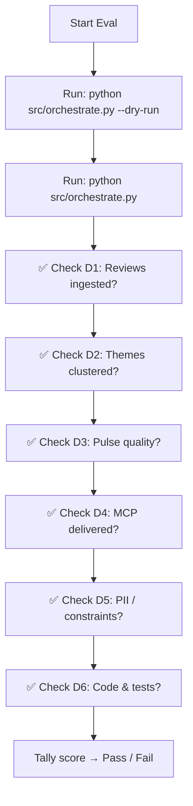
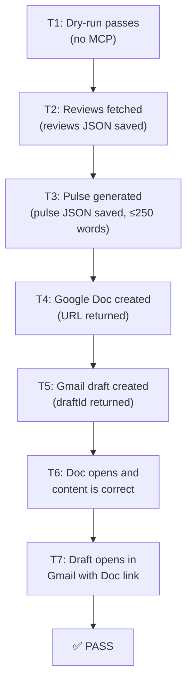

# 🧪 Groww Reviews MCP — Evaluation Rubric

> **Purpose:** Score and validate the completed pipeline against all project requirements.
> **Use when:** Doing a final demo review, grading a submission, or doing a self-assessment before sign-off.
> **References:** [`implementation-plan.md`](implementation-plan.md) · [`architecture.md`](architecture.md) · [`edge-cases.md`](edge-cases.md) · [`problemstatement.md`](problemstatement.md)

---

## Scoring Summary

| Dimension | Max Points | Self Score | Reviewer Score |
|---|---|---|---|
| [D1 — Review Ingestion](#d1--review-ingestion) | 20 | | |
| [D2 — Theme Clustering](#d2--theme-clustering) | 20 | | |
| [D3 — Pulse Quality](#d3--pulse-quality) | 20 | | |
| [D4 — MCP Integration](#d4--mcp-integration) | 20 | | |
| [D5 — Privacy & Constraints](#d5--privacy--constraints) | 10 | | |
| [D6 — Code Quality & Tests](#d6--code-quality--tests) | 10 | | |
| **Total** | **100** | | |

> **Pass threshold:** ≥ 70 / 100, with no 🔴 Critical dimension scoring zero.

---

## Evaluation Flow



---

## D1 — Review Ingestion

> **Max: 20 points** | Pipeline layer: `src/ingest.py`

### Checklist

| # | Criterion | Points | Pass? | Notes |
|---|---|---|---|---|
| D1.1 | Reviews are fetched from `com.nextbillion.groww` on Google Play Store | 4 | ☐ | |
| D1.2 | Reviews cover the last **8–12 weeks** (configurable via `config.yaml`) | 4 | ☐ | Check `week_ending` and earliest `date` in output JSON |
| D1.3 | At least **1 review** fetched (minimum viable); ideally 50+ for meaningful clustering | 3 | ☐ | |
| D1.4 | Output JSON contains **no PII fields**: `userName`, `userImage`, `reviewId`, `replyContent`, `repliedAt` | 5 | ☐ | Open `data/reviews_YYYY-MM-DD.json` and verify keys |
| D1.5 | Reviews fetched via **public, unauthenticated endpoint only** — no cookies, no login | 4 | ☐ | Inspect `ingest.py` for session/cookie/login code |

### How to Verify D1

```powershell
# Check output schema — no PII keys should appear
python -c "
import json
with open('data/reviews_2026-11-01.json') as f:
    d = json.load(f)
reviews = d['reviews']
pii_keys = {'userName','userImage','reviewId','replyContent','repliedAt'}
found = pii_keys & set(reviews[0].keys()) if reviews else set()
print('PII FOUND:', found or 'None ✅')
print('Review count:', len(reviews))
print('Earliest date:', min(r['date'] for r in reviews))
"
```

**Expected output:**
```
PII FOUND: None ✅
Review count: 342
Earliest date: 2026-08-01
```

---

## D2 — Theme Clustering

> **Max: 20 points** | Pipeline layer: `src/cluster.py`

### Checklist

| # | Criterion | Points | Pass? | Notes |
|---|---|---|---|---|
| D2.1 | Reviews are grouped into **at most 5 themes** | 5 | ☐ | Count themes in pulse JSON |
| D2.2 | Each theme has a **name**, **description**, and a list of **review indices** | 4 | ☐ | Inspect intermediate cluster output |
| D2.3 | Themes are **ranked by volume** (most-discussed first) | 3 | ☐ | Check `review_count` descending order |
| D2.4 | **Top 3 themes** are correctly selected for the pulse | 4 | ☐ | Pulse payload contains exactly 3 theme entries |
| D2.5 | Themes reflect **actual Groww user concerns** — not generic advice (e.g., "KYC", "Payments", "Crashes" — not "Improve UX") | 4 | ☐ | Manual review of theme names |

### How to Verify D2

```powershell
# Inspect the saved pulse JSON
python -c "
import json
with open('data/pulse_2026-11-01.json') as f:
    p = json.load(f)
print('Theme count:', len(p['top_themes']))
for t in p['top_themes']:
    print(f'  Rank {t[\"rank\"]}: {t[\"name\"]} ({t[\"review_count\"]} reviews) — {t[\"description\"]}')
"
```

**Expected output:**
```
Theme count: 3
  Rank 1: KYC Failures (128 reviews) — Users face repeated KYC rejections with no clear guidance.
  Rank 2: App Crashes (94 reviews) — Frequent crashes reported during portfolio load and trading.
  Rank 3: Slow Withdrawals (67 reviews) — Withdrawal processing takes longer than expected.
```

---

## D3 — Pulse Quality

> **Max: 20 points** | Pipeline layer: `src/pulse.py`

### Checklist

| # | Criterion | Points | Pass? | Notes |
|---|---|---|---|---|
| D3.1 | Pulse prose is **≤ 250 words** | 5 | ☐ | `len(prose.split()) <= 250` |
| D3.2 | Pulse contains exactly **3 verbatim user quotes** | 4 | ☐ | Each quote must appear as a substring in the source reviews |
| D3.3 | Quotes are **not paraphrased or invented** — must be real user text | 4 | ☐ | Spot-check 1–2 quotes against `data/reviews_*.json` |
| D3.4 | Pulse contains exactly **3 action ideas**, each starting with a verb | 4 | ☐ | Check first word of each action idea |
| D3.5 | Action ideas are **grounded in the themes** — not generic advice | 3 | ☐ | Each action idea should reference the theme it addresses |

### How to Verify D3

```powershell
# Word count + structure check
python -c "
import json
with open('data/pulse_2026-11-01.json') as f:
    p = json.load(f)

prose_words = p['word_count']
quotes = [t['quote'] for t in p['top_themes']]
actions = p['action_ideas']

print(f'Word count: {prose_words} / 250 {\"✅\" if prose_words <= 250 else \"❌ OVER LIMIT\"}')
print(f'Quotes:     {len(quotes)} {\"✅\" if len(quotes) == 3 else \"❌\"}')
print(f'Actions:    {len(actions)} {\"✅\" if len(actions) == 3 else \"❌\"}')

print()
for i, a in enumerate(actions, 1):
    verb_ok = a[0].isupper() and a.split()[0].isalpha()
    print(f'  Action {i}: {\"✅\" if verb_ok else \"❌\"} \"{a[:60]}...\"')
"
```

**Manual spot-check — verbatim quote verification:**
```powershell
python -c "
import json

with open('data/reviews_2026-11-01.json') as f:
    reviews = json.load(f)['reviews']
with open('data/pulse_2026-11-01.json') as f:
    pulse = json.load(f)

all_texts = [r['content'].lower() for r in reviews]

for t in pulse['top_themes']:
    q = t['quote'].lower().strip('\"')
    found = any(q[:40] in text for text in all_texts)
    print(f'  [{\"✅ VERBATIM\" if found else \"❌ NOT FOUND IN REVIEWS\"}] \"{t[\"quote\"][:60]}...\"')
"
```

---

## D4 — MCP Integration

> **Max: 20 points** | Pipeline layer: `src/mcp_docs.py` + `src/mcp_gmail.py`

### Checklist

| # | Criterion | Points | Pass? | Notes |
|---|---|---|---|---|
| D4.1 | Google Doc is **created via MCP tool call** — not via direct Google Docs REST API | 5 | ☐ | Inspect `mcp_docs.py` — no `requests` or `googleapiclient` imports |
| D4.2 | Google Doc exists in Drive with title `Groww Weekly Pulse — YYYY-MM-DD` | 4 | ☐ | Open the `docUrl` returned in the run log |
| D4.3 | Google Doc content matches the pulse prose (correct themes, quotes, actions) | 3 | ☐ | Open the Doc and visually verify |
| D4.4 | Gmail draft is **created via MCP tool call** — not via direct Gmail REST API | 5 | ☐ | Inspect `mcp_gmail.py` — no `requests` or `google.auth` imports |
| D4.5 | Gmail draft is **visible in Drafts** with correct subject and body (Doc link or inline pulse) | 3 | ☐ | Open Gmail → Drafts and verify |

### How to Verify D4

```powershell
# Check the run log for docUrl and draftId
python src/orchestrate.py 2>&1 | Select-String "docUrl|draftId|Doc URL|Draft ID"
```

**Expected log lines:**
```
[INFO] Google Doc created: https://docs.google.com/document/d/XXXX/edit
[INFO] Gmail draft created: draftId=r-XXXXXXX
[INFO] ✅ Pipeline complete — docUrl logged above
```

**Code audit — confirm no raw API calls:**
```powershell
# Should return NO results (no direct Google API usage)
Select-String -Path "src\mcp_docs.py","src\mcp_gmail.py" -Pattern "requests\.|googleapiclient|google\.auth|httpx\."
```

---

## D5 — Privacy & Constraints

> **Max: 10 points** | Cross-cutting concern across all layers

### Checklist

| # | Criterion | Points | Pass? | Notes |
|---|---|---|---|---|
| D5.1 | **No PII** in the Google Doc (no reviewer names, emails, phone numbers, device IDs) | 3 | ☐ | Open the Doc and visually scan; run regex check |
| D5.2 | **No PII** in the Gmail draft | 2 | ☐ | Open the draft and visually scan |
| D5.3 | Pulse word count is **≤ 250 words** (hard constraint enforced in code, not just by convention) | 2 | ☐ | Confirm `assert word_count <= 250` exists in `pulse.py` |
| D5.4 | **Themes capped at 5** — the cap is enforced in code, not just prompted | 2 | ☐ | Confirm merge logic exists in `cluster.py` |
| D5.5 | `.env` file is **gitignored** — API keys not committed to version control | 1 | ☐ | Check `.gitignore` contains `.env` |

### How to Verify D5 — Automated PII Scan

```powershell
# Regex scan the output pulse JSON for PII patterns
python -c "
import json, re

EMAIL_RE = re.compile(r'[a-zA-Z0-9_.+-]+@[a-zA-Z0-9-]+\.[a-zA-Z0-9-.]+')
PHONE_RE = re.compile(r'(\+91[\-\s]?)?[6-9]\d{9}')
NAME_RE  = re.compile(r'\b(userName|reviewId|userImage)\b')

with open('data/pulse_2026-11-01.json') as f:
    content = f.read()

hits = []
for pat, label in [(EMAIL_RE, 'EMAIL'), (PHONE_RE, 'PHONE'), (NAME_RE, 'PII_FIELD')]:
    for m in pat.finditer(content):
        hits.append(f'{label}: {m.group()}')

if hits:
    print('❌ PII FOUND:')
    for h in hits: print(' ', h)
else:
    print('✅ No PII detected in pulse JSON')
"
```

---

## D6 — Code Quality & Tests

> **Max: 10 points** | Pipeline layer: `tests/` + `src/`

### Checklist

| # | Criterion | Points | Pass? | Notes |
|---|---|---|---|---|
| D6.1 | `pytest tests/ -v` passes with **no failures** | 4 | ☐ | Run and attach output |
| D6.2 | Tests use **mocked LLM and scraper** — no real network calls in unit tests | 2 | ☐ | Inspect test files for `unittest.mock` / `pytest-mock` usage |
| D6.3 | `--dry-run` flag works and skips MCP calls entirely | 2 | ☐ | `python src/orchestrate.py --dry-run` completes without MCP errors |
| D6.4 | `config.yaml` externalises all tuneable parameters — no hardcoded values in `src/` | 1 | ☐ | Grep `src/` for hardcoded `"com.nextbillion.groww"`, `250`, `5`, email addresses |
| D6.5 | Code has at least minimal inline comments / docstrings on public functions | 1 | ☐ | Spot-check `ingest.py` and `cluster.py` |

### How to Verify D6

```powershell
# Run all tests
cd "c:\Projects\Grow reviwes_MCP"
.venv\Scripts\Activate.ps1
pytest tests/ -v --tb=short

# Dry-run check
python src/orchestrate.py --dry-run

# Hardcoded values audit
Select-String -Path "src\*.py" -Pattern '"com\.nextbillion|max_words\s*=\s*250|max_themes\s*=\s*5'
```

---

## Functional Acceptance Test — Full End-to-End

Run this sequence in order. Each step must pass before the next.



| Test | Command / Action | Expected Result | Pass? |
|---|---|---|---|
| **T1** | `python src/orchestrate.py --dry-run` | Exits 0; pulse printed to console; no MCP calls | ☐ |
| **T2** | Check `data/` for `reviews_*.json` | File exists; ≥ 1 review; no PII keys | ☐ |
| **T3** | Check `data/` for `pulse_*.json` | File exists; `word_count ≤ 250`; 3 themes; 3 quotes; 3 actions | ☐ |
| **T4** | Run log contains `docUrl` | URL starts with `https://docs.google.com/document/` | ☐ |
| **T5** | Run log contains `draftId` | Non-empty string | ☐ |
| **T6** | Open `docUrl` in browser | Groww pulse content visible; no PII; correct date | ☐ |
| **T7** | Open Gmail → Drafts | Draft with subject `[Groww Pulse]...` visible; contains Doc link | ☐ |

---

## Regression Check — Edge Case Coverage

Verify at least the **Critical (🔴)** edge cases from [`edge-cases.md`](edge-cases.md) are handled:

| EC ID | Scenario | How to Verify | Covered? |
|---|---|---|---|
| **EC-01** | Zero reviews returned | Mock empty scraper response → `IngestError` raised | ☐ |
| **EC-07** | PII in review text | Feed review with email address → `[REDACTED]` in output | ☐ |
| **EC-13** | LLM returns non-JSON | Mock LLM response as plain text → re-prompt triggered; error raised if 2nd also fails | ☐ |
| **EC-19** | LLM paraphrases quote | Quote not substring of source → fallback to code-selected quote | ☐ |
| **EC-20** | PII survives into quote | Inject phone number into quote string → redacted before pulse assembly | ☐ |
| **EC-24** | MCP server unreachable | Mock MCP connection error → `DeliveryError` with clear message | ☐ |
| **EC-31** | LLM API key invalid | Set bad key in `.env` → `ConfigError` raised immediately | ☐ |

---

## Score Card

Fill in after completing evaluation:

```
Evaluator: ___________________________    Date: ____________

D1 — Review Ingestion         _____ / 20
D2 — Theme Clustering         _____ / 20
D3 — Pulse Quality            _____ / 20
D4 — MCP Integration          _____ / 20
D5 — Privacy & Constraints    _____ / 10
D6 — Code Quality & Tests     _____ / 10
                              ─────────
TOTAL                         _____ / 100

Functional Tests Passed:      T1☐  T2☐  T3☐  T4☐  T5☐  T6☐  T7☐
Critical EC Coverage:         EC-01☐  EC-07☐  EC-13☐  EC-19☐  EC-20☐  EC-24☐  EC-31☐

Verdict:  ☐ PASS (≥70, no zero dimension)   ☐ FAIL

Notes:
___________________________________________________________________
___________________________________________________________________
___________________________________________________________________
```

---

## Grading Scale

| Score | Grade | Meaning |
|---|---|---|
| 90 – 100 | ⭐ Excellent | All requirements met; edge cases handled; clean code |
| 75 – 89 | ✅ Good | Core pipeline works end-to-end; minor gaps in testing or hardening |
| 60 – 74 | 🟡 Partial | Pipeline works but missing a major constraint (e.g., no PII check, or MCP not used) |
| < 60 | ❌ Incomplete | Core deliverable (Doc or Draft) not created, or critical constraint violated |

> [!IMPORTANT]
> Automatic **FAIL** conditions regardless of total score:
> - PII (username, email, phone) found in the Google Doc or Gmail draft
> - Google Docs or Gmail integrated via direct REST API (not MCP)
> - Reviews scraped behind a store login or using ToS-violating automation
> - Quotes are paraphrased or invented (not from actual review text)

