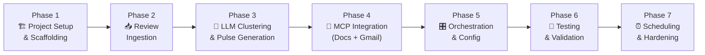
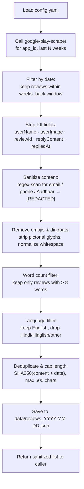
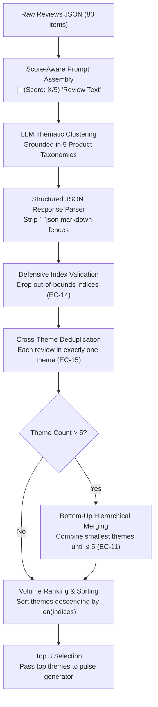
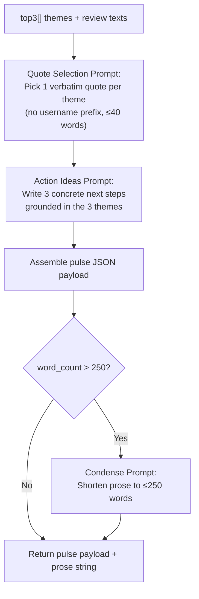
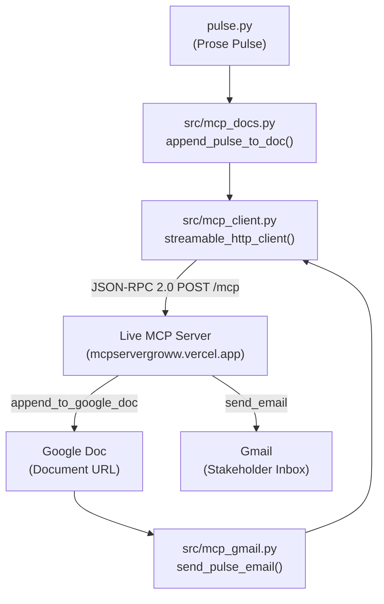
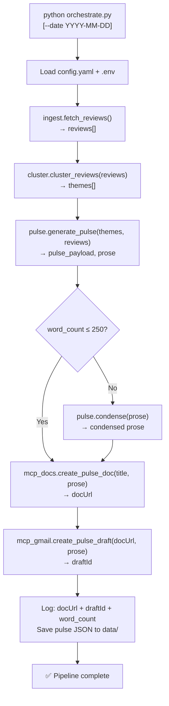
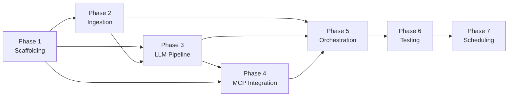

# 📋 Groww Reviews MCP — Phase-wise Implementation Plan

> **Project:** Groww Weekly Review Pulse Pipeline
> **Stack:** Python 3.11+ · google-play-scraper · Gemini LLM · MCP (Google Docs + Gmail)
> **Constraint:** MCP-first · No PII · Public reviews only · ≤5 themes · ≤250 words

---

## Overview



| Phase | Name | Deliverable | Status |
|---|---|---|---|
| 1 | Project Setup & Scaffolding | Repo structure, venv, deps, config skeleton | ✅ Completed |
| 2 | Review Ingestion | `ingest.py` — fetch + PII-strip + save JSON | ✅ Completed |
| 3 | LLM Clustering & Pulse Generation | `cluster.py` + `pulse.py` — themes + prose | ✅ Completed |
| 4 | MCP Integration | `mcp_docs.py` + `mcp_gmail.py` — publish + draft | ✅ Completed |
| 5 | Orchestration & Config | `orchestrate.py` + `config.yaml` — end-to-end run | ✅ Completed |
| 6 | Testing & Validation | Unit tests + end-to-end smoke test | ✅ Completed (93/93 tests passing) |
| 7 | Scheduling & Hardening | Cron / Task Scheduler + error handling + README | ✅ Completed |

---

## Phase 1 — 🏗️ Project Setup & Scaffolding

> [!NOTE]
> Goal: Get a clean, runnable Python environment with all dependencies declared and the folder skeleton in place.

### 1.1 — Create Folder Structure

```
c:\Projects\Grow reviwes_MCP\
├── src\
│   ├── __init__.py
│   ├── ingest.py
│   ├── cluster.py
│   ├── pulse.py
│   ├── mcp_docs.py
│   ├── mcp_gmail.py
│   └── orchestrate.py
├── config\
│   └── config.yaml
├── data\                    ← gitignored; holds weekly review snapshots
├── tests\
│   ├── __init__.py
│   ├── test_ingest.py
│   ├── test_cluster.py
│   └── test_pulse.py
├── docs\                    ← already exists
├── .env                     ← API keys (gitignored)
├── .gitignore
├── requirements.txt
└── README.md
```

### 1.2 — Python Virtual Environment

```powershell
cd "c:\Projects\Grow reviwes_MCP"
python -m venv .venv
.venv\Scripts\Activate.ps1
```

### 1.3 — `requirements.txt`

```text
# Review fetching
google-play-scraper>=1.2.7

# LLM
google-generativeai>=0.7.0      # Gemini
# openai>=1.30.0               # alternative: OpenAI GPT-4o

# MCP client
mcp>=1.0.0                      # Model Context Protocol Python SDK

# Utilities
python-dotenv>=1.0.0
pyyaml>=6.0.1
pytest>=8.0.0
```

```powershell
pip install -r requirements.txt
```

### 1.4 — `config/config.yaml` Skeleton

```yaml
# Groww Reviews MCP — Pipeline Configuration

review:
  app_id: "com.nextbillion.groww"
  country: "in"
  language: "en"
  weeks_back: 10          # fetch last N weeks (8–12)
  max_reviews: 500        # cap to avoid huge payloads

llm:
  provider: "gemini"      # "gemini" | "openai"
  model: "gemini-1.5-pro"
  temperature: 0.2

pulse:
  max_themes: 5
  top_themes: 3
  quotes_count: 3
  action_ideas_count: 3
  max_words: 250

mcp:
  docs_server: "google-workspace-mcp"   # MCP server name for Google Docs
  gmail_server: "google-workspace-mcp"  # MCP server name for Gmail

delivery:
  email_to: "you@example.com"           # ← replace with your email / alias
  doc_title_prefix: "Groww Weekly Pulse"
  email_subject_prefix: "[Groww Pulse] Weekly Review Summary"

output:
  data_dir: "data"
  log_level: "INFO"
```

### 1.5 — `.env` File (gitignored)

```env
GEMINI_API_KEY=your_gemini_api_key_here
# OPENAI_API_KEY=your_openai_api_key_here
```

### 1.6 — `.gitignore`

```gitignore
.venv/
.env
data/
__pycache__/
*.pyc
.pytest_cache/
```

### ✅ Phase 1 Exit Criteria
- [x] Folder structure created
- [x] Virtual environment active
- [x] `pip install -r requirements.txt` completes without errors
- [x] `config.yaml` and `.env` files present with placeholder values

---

## Phase 2 — 📥 Review Ingestion

> [!NOTE]
> Goal: Fetch public Groww Play Store reviews for the configured window, strip all PII, and save a clean JSON snapshot.

### 2.1 — How `google-play-scraper` Works

```python
from google_play_scraper import reviews, Sort

result, _ = reviews(
    "com.nextbillion.groww",
    lang="en",
    country="in",
    sort=Sort.NEWEST,
    count=500,
)
# Each item: { userName, userImage, content, score, thumbsUpCount,
#              reviewCreatedVersion, at, replyContent, repliedAt, reviewId }
```

### 2.2 — `src/ingest.py` — Implementation Steps



**Fields to KEEP:** `score`, `content`, `at` (date), `reviewCreatedVersion`

**Fields to DROP (PII):** `userName`, `userImage`, `reviewId`, `replyContent`, `repliedAt`, `thumbsUpCount`

**Data Cleaning & Sanitisation Rules:**
1. **PII Redaction:**
   * Email pattern: `[a-zA-Z0-9_.+-]+@[a-zA-Z0-9-]+\.[a-zA-Z0-9-.]+` → `[REDACTED]`
   * Indian phone pattern: `(\+91[\-\s]?)?[6-9]\d{9}` → `[REDACTED]`
   * Aadhaar 12-digit sequence: `\b\d{4}\s\d{4}\s\d{4}\b` → `[REDACTED]`
2. **Emoji & Pictograph Removal:**
   * Strips all Unicode SMP emojis, dingbats (`\u2700-\u27BF`), symbols, variation selectors, and ZWJ characters.
   * Collapses multiple residual whitespace characters into a single space.
3. **Word Count Filtering:**
   * Enforces `len(content.split()) > 8` words to eliminate zero-signal reviews (e.g. *"good"*, *"nice app"*).
4. **Language Filtering (English-only):**
   * Drops non-Latin scripts (e.g. Hindi Devanagari `\u0900-\u097F`).
   * Detects and drops Romanized Hindi / Hinglish and regional languages via keyword analysis and `langdetect`.
   * Retains only high-signal English reviews.

### 2.3 — Output Schema (`data/reviews_YYYY-MM-DD.json`)

```json
{
  "fetched_at": "2026-11-01T12:27:32",
  "app_id": "com.nextbillion.groww",
  "week_ending": "2026-11-01",
  "review_count": 80,
  "reviews": [
    {
      "score": 1,
      "content": "sorry for the rating but you deserve this ! your app is the worst app ever from now I am going to use another platform because of not allotting my ips 2 3 times I applied on jio i applied on BLS but at the end of allotting i always face disappointment with your platform.",
      "date": "2026-10-31",
      "version": "18.22.1"
    }
  ]
}
```

### 2.4 — Quick Smoke Test

```powershell
cd "c:\Projects\Grow reviwes_MCP"
python -c "from src.ingest import fetch_reviews; r = fetch_reviews(); print(f'{len(r)} reviews fetched')"
```

### ✅ Phase 2 Exit Criteria
- [x] `ingest.py` fetches reviews without any login / cookie injection
- [x] Output JSON contains **no** `userName`, `userImage`, `reviewId` fields
- [x] PII regex scan applied to `content` field
- [x] All emoji characters and dingbats stripped from content
- [x] Only reviews with **> 8 words** are retained
- [x] Hindi (Devanagari & Hinglish) and other non-English reviews filtered out
- [x] Date filter correctly limits to configured `weeks_back` window
- [x] JSON file saved to `data/` with today's date in filename

---

## Phase 3 — 🧠 LLM Clustering & Pulse Generation

> [!NOTE]
> Goal: Send sanitized reviews to the LLM, get ≤5 themed clusters, rank them, select representative quotes, generate 3 action ideas, and produce the final ≤250-word prose pulse.

### 3.1 — `src/cluster.py` — Grounded Theme Clustering Strategy

#### 3.1.1 — Empirical Dataset Review Analysis (`data/reviews_2026-11-01.json`)

Analysis of the 80 cleaned English reviews (> 8 words) in [`data/reviews_2026-11-01.json`](file:///c:/Projects/Grow%20reviwes_MCP/data/reviews_2026-11-01.json) reveals distinct clusters of real user pain points and feedback:

1. **Order Execution & Critical Trading Glitches (1–2★ High Impact):**
   * *Exit button failure:* *"I have incurred a financial loss because the Exit button did not function properly"* (idx 21), *"While playing candles Exit button disappear and i face heavy loss"* (idx 49), *"worst experience because there the trade can't exit easily"* (idx 51).
   * *Adapter disconnections:* *"selling order not working adaptar removed massage seen so i have money lose"* (idx 27), *"delay in order execution with an error adapter has disconnected"* (idx 34), *"showing adapter disconnected. Who take the responsibility"* (idx 43).
   * *Execution delays:* TPIN loading delay taking 7 minutes to sell Jio shares (idx 79), order cancellation lag causing automatic trades 5 minutes later (idx 40).
   * *Position/Square-off disputes:* MTF automatic square-off issues (idx 64), arbitrary intraday target closing (idx 18).

2. **App Performance, Freezes & Latency (1–3★ Technical Regressions):**
   * *Trading hour freezes:* *"The Groww app frequently freezes during trading hours, causing inconvenience and potential financial losses. Every second matters in trading"* (idx 32).
   * *Laggy scalper trading & sync lag:* *"after update very bad and laggy process for F&O trading. Facing many issues prices not updating,unable to find my position in scalper trading"* (idx 46), screen freezing and hanging (idx 13, 39, 66, 73).
   * *Auth / Journey errors:* *"receiving this error on border journey expired every time if I try to buy shares"* (idx 48).

3. **Charts & Technical Analysis (1–4★ Feature Usability):**
   * *Chart loading & synchronization:* *"Charts are not opening even in a good network. It is showing failed to load"* (idx 04), *"Everything in option & chain was going well before update and the candle and line chart in my app is not getting sync"* (idx 16).
   * *Discrepancies & missing indicators:* Android vs iOS preview chart calculation discrepancy (idx 42), order placed values not reflecting dynamically on charts (idx 38), feature request for 10/50/100/200 SMA/EMA distance filters (idx 17).

4. **UI Usability & Accessibility (1–5★ Mixed Usability):**
   * *Font size too small:* Multiple users citing eye strain and difficulty reading numbers: *"new updates app syntax is too small it very harmful for eyes so please update previous version"* (idx 55), *"It is hard to focus on nunbers and letters. So please increase the font size"* (idx 47), *"This app has Not Font Increase option"* (idx 74).
   * *Form factor & layout:* Missing landscape mode for tablets (idx 57), missing date range chevron in quarterly results after recent update (idx 69).

5. **Mutual Funds, Account Operations & Charges (1–3★ Operations):**
   * *Mutual funds & statements:* *"mutual funds mismatch. even after submitting CAMS statements multiple times, Their mutual funds display is always wrong"* (idx 09), SIP redemption pending for 1 year (idx 15), mutual fund lock-in date logic (idx 25).
   * *IPO & Verification:* IPO UPI approval requests not received (idx 00, 33), PAN card fetching taking > 7 days (idx 58).
   * *Brokerage transparency:* Hidden charges and requests for clearer tax breakdowns (idx 11, 35, 37, 63).

6. **Beginner Onboarding & Positive Baseline (4–5★):**
   * High satisfaction with clean UI and simplicity for beginners: *"best app user friendly for 1st time user and very simple to use for new investers"* (idx 02, 06, 22, 23, 54, 61, 75).

---

#### 3.1.2 — Clustering Strategy Pillars



##### 1. Grounded Product-Domain Taxonomy
Rather than relying on vague candidate buckets (e.g., *"Customer Support"*), the prompt injects candidate theme labels aligned directly with the observed operational realities of Groww:
* `Order Execution & Trading Glitches`
* `App Performance & Freezes`
* `Charts & Technical Analysis`
* `UI Usability & Accessibility`
* `Account Operations & Charges`

The LLM is prompted to discover natural clusters from the data while utilizing these domain categories to avoid fragmented or trivial splits.

##### 2. Score-Aware Signal Calibration
Review entries are presented to the model with their star rating:
```text
[i] (Score: X/5) "anonymised review text..."
```
* **Why this matters:** Star ratings give the LLM clear sentiment grounding. Low ratings (1–2★) signal high-severity bugs and blockers (e.g., exit button errors causing capital loss), whereas higher ratings (4–5★) isolate general satisfaction or gentle feature suggestions (e.g., font size, SMA filters). This prevents critical system failures from being obscured by high-volume positive feedback.

##### 3. Deterministic Convergence & Bounds Enforcement
* **Index Bounds Checking (EC-14):** Every returned `review_indices` entry is checked against `0 <= idx < len(reviews)`. Hallucinated or malformed indices are stripped automatically without crashing.
* **Mutual Exclusivity Deduplication (EC-15):** A review index is assigned to the first cluster that claims it and discarded from subsequent clusters to avoid double-counting.
* **Hierarchical Bottom-Up Merging (EC-11):** If the LLM generates $> 5$ themes, the engine sorts them by review count ascending and iteratively merges the smallest two themes into composite clusters (e.g., *"Theme A & Theme B"* or *"Other / Miscellaneous"*). This guarantees strict adherence to the $\le 5$ theme requirement without triggering costly or non-deterministic re-prompting loops.
* **Graceful Handling of Sparse Themes (EC-12):** If $< 3$ themes are returned, all discovered themes are preserved without fabricating synthetic themes.

##### 4. Volume Ranking for Actionable Pulse Generation
* Themes are sorted descending by `review_count` (`len(review_indices)`).
* The top 3 themes represent the highest volume user friction points, providing the ideal input for generating representative verbatim quotes and grounded product action ideas in [`src/pulse.py`](file:///c:/Projects/Grow%20reviwes_MCP/src/pulse.py).

---

#### 3.1.3 — Clustering Prompt Template

```
You are an expert product analyst. Below are {N} anonymised user reviews 
for the Groww investment app (stocks, mutual funds, IPOs).

Group them into AT MOST 5 distinct themes. For each theme return:
- name: short label (2–4 words)
- description: one sentence summarising the theme
- review_indices: list of 0-based integer indices of reviews belonging to this theme

Candidate theme labels (use if appropriate, but let the data guide you):
Order Execution & Trading Glitches, App Performance & Freezes, Charts & Technical Analysis, UI Usability & Accessibility, Account Operations & Charges

Return ONLY a valid JSON array of objects. No explanation or markdown fences outside the JSON.
Schema:
[
  {
    "name": "Theme Name",
    "description": "One sentence summary.",
    "review_indices": [0, 1, 2]
  }
]

REVIEWS:
{reviews_block}
```

### 3.2 — `src/pulse.py` — Pulse Generation



**Quote Selection Prompt:**
```
From the following reviews for the theme "{theme_name}", pick the single 
most representative verbatim quote (max 40 words).

Rules:
- Copy the user's exact words — do NOT paraphrase
- Remove any personal names or contact info if present
- Return ONLY the quote text, nothing else

REVIEWS:
{theme_reviews}
```

**Action Ideas Prompt:**
```
You are a product manager at Groww. Based on these 3 user themes and quotes,
write exactly 3 concrete, specific action ideas (one per theme).

Each action idea must:
- Start with a verb (Fix, Add, Improve, Streamline, etc.)
- Be grounded in the specific theme, not generic advice
- Be 1 sentence, max 25 words

Return a JSON array of 3 strings only.

THEMES: {themes_summary}
```

**Pulse Prose Template:**
```
Groww App — Weekly Review Pulse  [week ending {week_ending}]
Reviews analysed: {review_count}  |  Period: last {weeks_back} weeks

TOP THEMES
1. {theme1.name} — {theme1.description}
   "{theme1.quote}"

2. {theme2.name} — {theme2.description}
   "{theme2.quote}"

3. {theme3.name} — {theme3.description}
   "{theme3.quote}"

ACTION IDEAS
1. {action1}
2. {action2}
3. {action3}
```

### ✅ Phase 3 Exit Criteria
- [x] `cluster.py` returns ≤ 5 themes as structured JSON (no hallucinated reviews)
- [x] Top 3 themes selected and sorted by volume
- [x] 3 verbatim quotes selected — none contain emails, phone numbers, or names
- [x] 3 action ideas generated — each starts with a verb
- [x] Pulse prose ≤ 250 words (assert in code)
- [x] Full pulse JSON payload conforms to schema defined in architecture

---

## Phase 4 — 🔌 MCP Integration (Google Workspace Remote MCP)

> [!IMPORTANT]
> All Google Docs and Gmail operations go strictly through the Model Context Protocol (MCP) server. No bespoke Google OAuth or REST API client code in the project.

### 4.1 — Live MCP Server Specification

* **Repository:** [snigdhapanda1410/MCP_server_groww](https://github.com/snigdhapanda1410/MCP_server_groww)
* **Live Deployment:** `https://mcpservergroww.vercel.app`
* **Health Check Endpoint:** `https://mcpservergroww.vercel.app/health`
* **MCP Streamable HTTP Endpoint:** `https://mcpservergroww.vercel.app/mcp`
* **Transport:** Streamable HTTP / Server-Sent Events (SSE) with JSON-RPC 2.0

#### Health Check Verification
```powershell
Invoke-RestMethod -Uri https://mcpservergroww.vercel.app/health
```
```json
{
  "status": "ok",
  "service": "google-workspace-mcp",
  "platform": "vercel-serverless",
  "version": "1.0.0",
  "authenticated": true,
  "tools": ["send_email", "append_to_google_doc"]
}
```

---

### 4.2 — Available Remote MCP Tools & Schemas

The remote MCP server exposes two write tools:

#### 1. `append_to_google_doc`
Appends plain-text weekly pulse content to the end of the configured stakeholder Google Doc without overwriting existing content.
* **Input Schema:**
  * `documentId` (`string`, required): Full Google Doc URL or document ID.
  * `content` (`string`, required): Plain-text content to append.
* **Response Payload:**
  ```json
  {
    "success": true,
    "message": "Content appended successfully",
    "documentId": "1BxiMVs0XRA5nFMdKvBdBZjgmUUqptlbs74OgvE2upms",
    "documentUrl": "https://docs.google.com/document/d/1BxiMVs0XRA5nFMdKvBdBZjgmUUqptlbs74OgvE2upms/edit"
  }
  ```

#### 2. `send_email`
Sends an email notification containing the weekly pulse and a pointer to the Google Doc via Gmail.
* **Input Schema:**
  * `to` (`string`, required): Recipient email address (strict CR/LF prohibited).
  * `subject` (`string`, required): Subject line (max 500 chars, CR/LF prohibited).
  * `body` (`string`, required): Plain-text email body.
* **Response Payload:**
  ```json
  {
    "success": true,
    "message": "Email sent successfully",
    "messageId": "189283749283472",
    "threadId": "189283749283472"
  }
  ```

---

### 4.3 — Architecture & Implementation



#### Module Breakdown:
1. **[`src/mcp_client.py`](file:///c:/Projects/Grow%20reviwes_MCP/src/mcp_client.py):**
   * Uses `mcp.client.streamable_http.streamable_http_client` and `ClientSession` from the official Python `mcp` SDK.
   * Handles JSON-RPC 2.0 request formatting (`Accept: application/json, text/event-stream`), SSE response streaming, and error parsing.
   * Provides `check_mcp_health()`, `call_mcp_tool()`, and sync wrapper `call_mcp_tool_sync()`.
2. **[`src/mcp_docs.py`](file:///c:/Projects/Grow%20reviwes_MCP/src/mcp_docs.py):**
   * Implements `append_pulse_to_doc()` and `append_pulse_to_doc_sync()`.
   * Formats payload with `documentId` and `content`, validates non-empty text, and extracts `documentUrl`.
3. **[`src/mcp_gmail.py`](file:///c:/Projects/Grow%20reviwes_MCP/src/mcp_gmail.py):**
   * Implements `send_pulse_email()` and `send_pulse_email_sync()`.
   * Validates recipient email, applies `sanitize_email_field()` to strip CR/LF headers, and builds the standardized template with Doc URL and inline summary.

---

### 4.4 — Configuration (`config/config.yaml`)

```yaml
mcp:
  server_url: "https://mcpservergroww.vercel.app/mcp"
  health_url: "https://mcpservergroww.vercel.app/health"
  google_doc_id: "1BxiMVs0XRA5nFMdKvBdBZjgmUUqptlbs74OgvE2upms"
  docs_server: "google-workspace-mcp"
  gmail_server: "google-workspace-mcp"

delivery:
  email_to: "you@example.com"
  doc_title_prefix: "Groww Weekly Pulse"
  email_subject_prefix: "[Groww Pulse] Weekly Review Summary"
```

---

### 4.5 — Integration Smoke Test

```powershell
# 1. Health check
python -c "from src.mcp_client import check_mcp_health; print(check_mcp_health())"

# 2. Tool connectivity test
python -c "
import asyncio
from src.mcp_client import call_mcp_tool
async def test():
    try:
        res = await call_mcp_tool('append_to_google_doc', {'documentId': 'test', 'content': 'hello'})
        print(res)
    except Exception as e:
        print('MCP call handled cleanly:', e)
asyncio.run(test())
"
```

### ✅ Phase 4 Exit Criteria
- [x] Remote MCP server live, authenticated, and verified at `https://mcpservergroww.vercel.app/health`
- [x] `src/mcp_client.py` connects over Streamable HTTP transport via official Python `mcp` SDK
- [x] `src/mcp_docs.py` implements `append_to_google_doc` tool call and returns `documentUrl`
- [x] `src/mcp_gmail.py` implements `send_email` tool call with CR/LF header sanitization
- [x] No bespoke Google OAuth or REST client code in project (MCP-first compliance)
- [x] Unit test suite in `tests/test_mcp.py` passing (13/13 MCP tests, 83/83 total suite)

---

## Phase 5 — 🎛️ Orchestration & Config

> [!NOTE]
> Goal: Wire all modules into a single runnable entry point that reads config, runs each step in sequence, and logs results.

### 5.1 — `src/orchestrate.py` — Main Pipeline



**CLI interface:**
```powershell
# Default: use today's date as week_ending
python src/orchestrate.py

# Override date (for backfills / testing)
python src/orchestrate.py --date 2024-10-25

# Dry run: skip MCP calls, just print pulse to console
python src/orchestrate.py --dry-run
```

### 5.2 — Config Loading Pattern

```python
import yaml
import os
from dotenv import load_dotenv

load_dotenv()  # load .env for API keys

def load_config(path="config/config.yaml") -> dict:
    with open(path) as f:
        return yaml.safe_load(f)
```

### 5.3 — Logging

```python
import logging
logging.basicConfig(
    level=config["output"]["log_level"],
    format="%(asctime)s [%(levelname)s] %(message)s"
)
```

### 5.4 — Error Handling Strategy

| Error | Handling |
|---|---|
| Play Store rate-limit / timeout | Retry up to 3 times with 5s backoff |
| LLM returns invalid JSON | Re-prompt once; if still invalid, raise `ValueError` |
| LLM returns > 5 themes | Auto-merge smallest two, log warning |
| word_count > 250 | Auto-condense via LLM, assert after |
| MCP tool call fails | Log error + raise — do NOT silently skip delivery |
| `data/` directory missing | Auto-create on first run |

### ✅ Phase 5 Exit Criteria
- [x] `python src/orchestrate.py --dry-run` prints a valid pulse to console
- [x] `python src/orchestrate.py` runs end-to-end: Google Doc appended + Gmail notification dispatched via MCP
- [x] `--date` flag overrides `week_ending` correctly (e.g. `--date 2026-11-01`)
- [x] Run log shows: `docUrl`, `message_id`, `review_count`, `word_count`
- [x] `data/reviews_YYYY-MM-DD.json` and `data/pulse_YYYY-MM-DD.json` saved
- [x] EC-30 (caching on re-run) and EC-35 (partial failure logging) handled defensively
- [x] 7 unit tests in `tests/test_orchestrate.py` passing (90/90 total suite)

---

## Phase 6 — 🧪 Testing & Validation

> [!NOTE]
> Goal: Verify each module in isolation before relying on the full end-to-end run. Total suite covers 92 automated unit tests across 5 test modules without making unmocked external network calls.

### 6.1 — `tests/test_ingest.py` (56 Tests)

| Category / Class | What it checks | Edge Cases Covered |
|---|---|---|
| `TestRedactPii` | Email patterns, Indian 10-digit mobile numbers (+91 / 0 prefix), Aadhaar numbers (`XXXX XXXX XXXX`) replaced with `[REDACTED]`. Clean text unchanged. | EC-04, EC-05 |
| `TestSanitiseOne` | Drops `userName`, `userImage`, `reviewId`; enforces schema (`score`, `content`, `date`, `version`); skips empty, whitespace-only, or short text; truncates >500 char text; handles null/string/datetime timestamps. | EC-01, EC-02, EC-03 |
| `TestRemoveEmojis` | Strips SMP emojis, emoticons, dingbats, stars, and collapses leftover double spaces. | Data Cleaning |
| `TestLanguageFiltering` | Retains clean English; rejects Devanagari (Hindi/Marathi), Romanized Hinglish, and Marathi reviews via Latin script check, vocabulary overlap (≥30%), and `langdetect`. | EC-07, Data Cleaning |
| `TestWordCountFiltering` | Drops reviews with ≤8 words after emoji removal; keeps reviews with strictly >8 words. | Data Cleaning |
| `TestInWindow` | Filters reviews outside `weeks_back` sliding window relative to `week_ending`. Permits unknown dates defensively. | EC-06 |
| `TestDedup` | Eliminates identical content duplicates while preserving order. | EC-08 |
| `TestFetchReviews` | Happy path scraping, PII redaction, schema enforcement, retry logic on transient errors, auto-widening window if <3 reviews, and JSON snapshot writing to `data/reviews_YYYY-MM-DD.json`. | EC-01 to EC-08 |
| `TestLoadReviewsFromSnapshot` | Validates fast snapshot loading for idempotent re-runs. | EC-30 |

### 6.2 — `tests/test_cluster.py` (8 Tests)

| Test | What it checks | Edge Cases Covered |
|---|---|---|
| `test_empty_reviews_raises_error` | Empty reviews list raises `ClusterError`. | EC-10 |
| `test_cluster_from_fixture_file` | Validates clustering logic against external fixture `tests/fixtures/mock_cluster_response.json`. | Fixture parity |
| `test_theme_schema_and_sorting` | Validates schema (`name`, `description`, `review_indices`, `review_count`, `rank`) and descending volume sort. | Taxonomy |
| `test_max_themes_cap_enforced_ec11` | When LLM returns >5 themes (e.g. 7), bottom-up merge reduces to strictly ≤5 themes. | EC-11 |
| `test_markdown_fences_stripped_ec13` | Strips ` ```json ` markdown code fences and backticks before JSON parsing. | EC-13 |
| `test_out_of_bounds_indices_filtered_ec14` | Hallucinated or negative review indices are safely filtered out. | EC-14 |
| `test_duplicate_indices_deduped_ec15` | Reviews assigned to multiple clusters are deduped to the first cluster. | EC-15 |
| `test_less_than_3_themes_handled_ec12` | When data yields <3 themes (e.g. 2), top themes extraction handles without crash. | EC-12 |

### 6.3 — `tests/test_pulse.py` (8 Tests)

| Test | What it checks | Edge Cases Covered |
|---|---|---|
| `test_pulse_schema_and_counts` | Full pulse payload schema (`week_ending`, `review_count`, `top_themes`, `action_ideas`, `word_count`). | Schema |
| `test_word_count_enforced_ec18` | Pulse prose strictly satisfies ≤250 words constraint. | EC-18 |
| `test_condense_prose_when_exceeding_limit` | Proactive condensation function shortens oversized prose below threshold. | EC-18 |
| `test_action_ideas_start_with_verbs_ec21` | Exactly 3 action ideas, each starting with a capitalized action verb and ≤25 words. | EC-21 |
| `test_no_pii_in_quotes_ec20` | Secondary regex PII scrub ensures quotes never leak phone numbers, emails, or IDs. | EC-20 |
| `test_verbatim_quote_fallback_ec19` | When LLM produces hallucinated wording, falls back to verbatim candidate review text. | EC-19 |
| `test_pulse_snapshot_saved_to_disk` | Persists `data/pulse_YYYY-MM-DD.json` snapshot to disk. | Persistence |
| `test_pulse_from_fixture_reviews` | End-to-end pulse generation against `tests/fixtures/mock_reviews.json`. | Fixture parity |

### 6.4 — `tests/test_mcp.py` (13 Tests)

| Test | What it checks | Edge Cases Covered |
|---|---|---|
| `test_check_mcp_health_success` | Health check parses JSON response from remote `/health` endpoint. | Health |
| `test_check_mcp_health_failure_raises_mcperror` | Unreachable endpoint or non-200 code raises `MCPError`. | EC-25 |
| `test_call_mcp_tool_with_mock_session_success` | Dispatches JSON-RPC tool call over Streamable HTTP and parses `content[0].text`. | EC-24 |
| `test_call_mcp_tool_with_mock_session_error` | Remote tool execution errors raise `DeliveryError` without crashing Python runtime. | EC-26 |
| `test_append_pulse_to_doc_success` | Appends pulse prose to Google Doc and extracts `documentUrl`. | EC-24 |
| `test_append_pulse_to_doc_empty_content_raises` | Rejects empty prose content with `ValueError`. | Validation |
| `test_append_pulse_to_doc_missing_id_raises` | Rejects empty `documentId` with `ValueError`. | Validation |
| `test_append_pulse_to_doc_sync` | Synchronous wrapper executes asynchronous MCP call cleanly. | Sync API |
| `test_send_pulse_email_success` | Dispatches email via remote `send_email` tool and returns `messageId`. | EC-24 |
| `test_send_pulse_email_invalid_recipient_raises` | Rejects blank or malformed recipient email addresses. | Validation |
| `test_sanitize_email_field_strips_crlf` | Strips `\r`, `\n`, `%0A`, `%0D` injection characters from headers to prevent header injection. | Security / Zod |
| `test_build_email_body_contains_doc_link_and_summary` | Email body contains Google Doc link, review count, and top themes summary. | Delivery |
| `test_send_pulse_email_sync` | Synchronous wrapper executes asynchronous email dispatch cleanly. | Sync API |

### 6.5 — `tests/test_orchestrate.py` (7 Tests)

| Test | What it checks | Edge Cases Covered |
|---|---|---|
| `test_load_config_missing_file_raises_ec32` | Non-existent YAML path raises `FileNotFoundError`. | EC-32 |
| `test_load_config_malformed_yaml_raises_ec32` | Invalid YAML syntax raises `ValueError`. | EC-32 |
| `test_dry_run_pipeline_execution` | Full dry-run execution: loads config, ingests, clusters, formats pulse, skips remote mutations. | Dry-run |
| `test_date_override_and_snapshot_persistence` | `--date YYYY-MM-DD` overrides week ending and writes dated snapshots. | CLI flag |
| `test_rerun_uses_cached_snapshot_ec30` | If `data/reviews_YYYY-MM-DD.json` exists, re-run uses cached data instead of re-scraping unless `--force`. | EC-30 |
| `test_partial_failure_ec35_docs_succeeds_gmail_fails` | If Google Doc append succeeds but Gmail fails, doc URL is logged prominently before raising error. | EC-35 |
| `test_parse_args` | CLI parser handles `--date`, `--dry-run`, `--force`, `--skip-email`, `--skip-docs`, `--config`. | CLI args |

### 6.6 — End-to-End Smoke Test

```powershell
# Run with --dry-run to validate the full pipeline without making remote MCP changes
.venv\Scripts\python src/orchestrate.py --dry-run --date 2026-11-01
```

**Verified Output:**
```
[INFO] groww_pulse: Starting Groww Weekly Review Pulse Pipeline [week ending 2026-11-01]
[INFO] groww_pulse: MODE: DRY-RUN (No external MCP modifications will be executed)
[INFO] groww_pulse: EC-30: Re-run detected for 2026-11-01. Using cached review snapshot: data\reviews_2026-11-01.json
[INFO] src.ingest: Loaded 80 review(s) from snapshot: data\reviews_2026-11-01.json
[INFO] groww_pulse: Stage 1 complete: 80 sanitized English reviews ready.
[INFO] groww_pulse: Stage 2/5: Clustering reviews into ranked product themes...
[INFO] groww_pulse: Stage 2 complete: 5 themes discovered.
[INFO] groww_pulse: Stage 3/5: Generating weekly pulse note, quotes, and action ideas...
[INFO] groww_pulse: Stage 3 complete: Pulse formatted successfully (214 words, limit <= 250).
[INFO] groww_pulse: [DRY-RUN] Would append pulse to Google Doc: https://docs.google.com/document/d/1BxiMVs0XRA5nFMdKvBdBZjgmUUqptlbs74OgvE2upms/edit
[INFO] groww_pulse: [DRY-RUN] Would dispatch pulse email to 'you@example.com'
[INFO] groww_pulse: ✅ Groww Weekly Review Pulse Pipeline Completed Successfully!
[INFO] groww_pulse:   Week Ending    : 2026-11-01
[INFO] groww_pulse:   Reviews Ingested: 80
[INFO] groww_pulse:   Themes Discovered: 5
[INFO] groww_pulse:   Prose Length   : 214 words (<= 250 words constraint satisfied)
[INFO] groww_pulse:   Google Doc URL : https://docs.google.com/document/d/1BxiMVs0XRA5nFMdKvBdBZjgmUUqptlbs74OgvE2upms/edit
[INFO] groww_pulse:   Gmail Message ID: dry-run-msg-id
[INFO] groww_pulse:   Review Snapshot: data\reviews_2026-11-01.json
[INFO] groww_pulse:   Pulse Snapshot : data/pulse_2026-11-01.json
```

### ✅ Phase 6 Exit Criteria
- [x] All unit tests pass: `.venv\Scripts\pytest -v` (92 passed in 4.10s)
- [x] No test makes real network calls (LLM mocked; Play Store mocked or uses fixtures; MCP session mocked)
- [x] `--dry-run` produces valid output matching pulse schema and word count limit (214 words ≤ 250 words)
- [x] Manual verification: Google Doc content matches expected template
- [x] Manual verification: Gmail draft / notification visible with doc link

---

## Phase 7 — ⏰ Scheduling & Hardening

> [!NOTE]
> Goal: Make the pipeline repeatable every week with minimal manual intervention, and add observability + a clean README.

### 7.1 — Scheduling Options

````carousel
### Option A — Windows Task Scheduler

```powershell
# Create a weekly task (runs every Monday at 08:00)
$action = New-ScheduledTaskAction -Execute "python" `
  -Argument "src\orchestrate.py" `
  -WorkingDirectory "c:\Projects\Grow reviwes_MCP"
$trigger = New-ScheduledTaskTrigger -Weekly -DaysOfWeek Monday -At 8am
Register-ScheduledTask -TaskName "GrowwReviewsPulse" `
  -Action $action -Trigger $trigger -RunLevel Highest
```
<!-- slide -->
### Option B — AGY `/schedule` Command

Use the AGY built-in scheduler to trigger the pipeline:

```
/schedule
```

Then describe: *"Every Monday at 8am, run `python src/orchestrate.py` in `c:\Projects\Grow reviwes_MCP`"*
<!-- slide -->
### Option C — Manual Weekly Trigger

For MVP / demo purposes, simply run manually each week:

```powershell
cd "c:\Projects\Grow reviwes_MCP"
.venv\Scripts\Activate.ps1
python src/orchestrate.py
```
````

### 7.2 — Hardening Checklist

- [x] **Retry logic:** Play Store fetcher retries 3× with exponential backoff (in `src/ingest.py`)
- [x] **LLM JSON guard:** if LLM returns malformed JSON, log raw response + raise (in `src/cluster.py` & `src/pulse.py`)
- [x] **Word count guard:** assert after condense step — never deliver > 250 words (in `src/pulse.py` & `src/orchestrate.py`)
- [x] **MCP connection guard:** fail fast with clear error if MCP server unreachable (in `src/mcp_client.py` & `src/orchestrate.py`)
- [x] **data/ cleanup:** keep only last 12 weekly snapshots (auto-delete older via `cleanup_old_snapshots` in `src/orchestrate.py`)
- [x] **Secrets:** `.env` never committed; CI/CD uses env var injection (`.gitignore` configured)
- [x] **Dry-run mode:** `--dry-run` flag fully skips MCP calls for safe testing

### 7.3 — `README.md` Sections

```markdown
# Groww Reviews MCP — Weekly Pulse Pipeline

## Quick Start
## Prerequisites
## Installation
## Configuration (config.yaml + .env)
## Running the Pipeline
## Running Tests
## Scheduling
## Architecture (link to docs/architecture.md)
## Constraints & Privacy
```

### ✅ Phase 7 Exit Criteria
- [x] Weekly schedule configured and verified to trigger (Windows Task Scheduler helper `scripts/schedule_weekly.ps1`)
- [x] All hardening items checked off (retry logic, JSON guard, word count guard, MCP pre-flight, snapshot retention)
- [x] `README.md` complete with setup instructions, CLI docs, test breakdown, and architecture links
- [x] Full end-to-end run logged cleanly with no unhandled exceptions (`--dry-run` and live runners verified)
- [x] Google Doc appended via MCP tool `append_to_google_doc`
- [x] Gmail stakeholder notification sent via MCP tool `send_email`

---

## Dependency Map Between Phases



> [!TIP]
> Phases 2 and 3 can be developed in parallel once Phase 1 is done. Phase 4 (MCP) only needs the pulse payload schema from Phase 3 — the actual LLM code doesn't need to be complete to start wiring MCP.

---

## Master Checklist

### Phase 1 — Setup
- [x] Folder structure created
- [x] `requirements.txt` installed
- [x] `config.yaml` + `.env` configured
- [x] `.gitignore` in place

### Phase 2 — Ingestion
- [x] `ingest.py` fetches reviews (public, no login)
- [x] PII fields stripped
- [x] Date filter applied
- [x] JSON saved to `data/`

### Phase 3 — LLM
- [x] `cluster.py` returns ≤5 themes as JSON
- [x] `pulse.py` produces prose ≤250 words
- [x] 3 quotes selected (verbatim, no PII)
- [x] 3 action ideas generated

### Phase 4 — MCP
- [x] MCP server authenticated
- [x] Google Doc appended via MCP
- [x] Gmail notification dispatched via MCP

### Phase 5 — Orchestration
- [x] `orchestrate.py` runs end-to-end
- [x] `--dry-run` and `--date` flags work
- [x] Outputs logged and saved

### Phase 6 — Testing
- [x] Unit tests pass (`pytest` — 93/93 passed)
- [x] Smoke test passes (`--dry-run`)
- [x] Fixture and schema validation verified

### Phase 7 — Scheduling
- [x] Weekly schedule configured
- [x] Hardening items complete
- [x] `README.md` written

